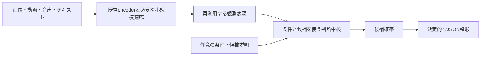

# 次の開発戦略：判断能力の改善を実入力までつなぐ

2026-10-15。ユーザーの「これまでを整理して戦略を組む」への回答。
参照状態は `a5a3a56fbd1057fc60dd13dc7fb56ff42e5a8549`。fetch後のリモート差分は0。
[過去の戦略・証拠集](STRATEGY_20261015.md)と各固定プロトコルを保持する。

## 1. 目標と最初の実用軸

**量子化前の全常駐パラメーター200M以下で、テキスト・画像・音声・動画から、
指定された候補の確率をJSONで返すOmni Decisionモデル**を作る。センサーは任意。
同じ観測を複数の判断に再利用し、条件なしと条件付きの判断を扱う。
全入力の文字起こしや文章生成用decoderを必須にしない。

最初の実用軸は、ローカル自動化の前段となる**条件付きの状態・イベント判定**とする。
「どの対象が条件に合うか」「何が先に起きたか」「音と映像が同じ事象を示すか」を、候補を差し替えて判断する。
この用途設定は評価を具体化するためで、四モダリティや難しい課題を完成条件から外すものではない。

95%以上、98%を目指す目標は、事前に固定した各必須課題で確認する。
未知の条件表現・候補説明・場面・組合せへの転移を含め、平均値で弱い課題を隠さない。
任意の未定義問題で95–98%を保証できるという証拠はない。

JSONは候補確率を通常のコードで整形する。排他的な多択は候補間softmax、独立した複数のyes/noは個別確率とする。
二択と多択を別々の製品路線にしない。保留を導入する場合も全件Accuracyと回答率を併記し、難しい例を除外しない。

## 2. 現在の証拠

以下の精度は異なる開発課題の値であり、四モダリティの統一テスト結果ではない。

| 実測・状態 | 戦略上の判断 |
|---|---|
| 生入力処理、特徴再利用、JSON、save/reloadは実行済み | この基盤を使い続ける |
| 195.42Mの構成要素の同時常駐を確認 | サイズの見通しはあるが、一つの高品質製品は未完成 |
| DeBERTaの40候補判断は採点方式変更で34.08%→59.08%、最弱構文25% | 条件理解には改善余地がある。採用条件には未達 |
| 正しい構造化状態でも、要求と無関係な正しい値を選ぶ | 知覚だけを強化しても、この判断側の失敗は解消しない |
| 画像は集計91.94%でも数え上げ70.51% | 能力別評価を維持する |
| 動画の空間・時間判断は38.91%、条件変更ペアの両問正解0/127 | 同じ少数シーンでのhead・学習量探索を続けない |
| AV対応付けはランダム候補94.85%、近い候補84.08% | 簡単な候補だけの高得点では不十分 |
| 別のAV共同分類では映像を取り違えても回答が変わらなかった | 入力の必要性を対照実験で確認する |
| 新規教師データ23,552問を生成・検算済み | 学習準備の成果。新モデルの精度はまだ測っていない |

根拠：[常駐数](R2_SHARED_RESIDENT_BUDGET_20261012.md)、
[条件理解](R2_FACTORIZED_REPRESENTATION_RESULTS_20261015.md)、
[画像](R2_AFFINE_REGULARIZATION_RESULTS_20261012.md)、
[動画](R2_SPATIAL_READOUT_RESULTS_20261014.md)、
[共同分類](R2_LOMBARD_VISUAL_STATE_RESULTS_20261015.md)、
[AV対応付け](R2_LOMBARD_CORRESPONDENCE_RESULTS_20261015.md)、
[新規データ](R2_DECISION_SUPERVISION_RESULTS_20261015.md)。

「200Mでは不可能」「学習量だけが不足」「encoderだけが原因」とは断定できない。
条件理解、知覚情報の保持、時間関係、入力間の対応付けを分けて調べる。

## 3. 主線は既存encoder＋学習する判断中核

| 進路 | 今回の扱い | 理由 |
|---|---|---|
| 既存の画像／動画・音声encoderと小型言語経路を再利用（Architecture A） | **主線** | 実行済み部品を使い、判断側と知覚側を別々に改善できる |
| 共有Transformer／Modality Lens | 診断で必要になった場合だけ比較 | 追加学習で品質と全体コストが改善する証拠が必要 |
| 大きなTeacherの再学習・全面蒸留や量子化先行 | 現段階では追加しない | 現在の弱点を解く教師品質・圧縮前品質が成立していない |

Architecture Aはencoderを永久に凍結するという意味ではない。情報が不足した経路だけを小さく適応する。
互換重みの統合も、解くべき問題と利益が確認できた場合に限定する。

凍結表現＋軽量な適応は[VideoPrism公式実装](https://github.com/google-deepmind/videoprism)でも扱われる。
ただし外部ベンチマークの成績を、本プロジェクトの時間・条件判断の成績には転用しない。

## 4. 次の学習は1本、その次は実入力との比較

### 第一段階：固定済みデータで判断能力の改善を測る

次の研究用比較候補として、既にロード・実測済みのDeBERTa xsmall（70.83M）を優先する。
これは製品採用や容量効果の証明ではない。NLI事前学習だけでは現在の課題を解けないことも実測済みである。
同じ初期重み・入力方式のstep 0に対し、一つの固定学習レシピを比較する。
学習全体の効果と、個々の教師信号・モデル容量の因果効果を混同しない。

- 凍結済みTRAIN16,384問、selection3,072問、既存replay2,048問と保持確認5,612問を利用する。
  新規23,552問全体は2,432状態から作られた限定的な構文・語彙の開発課題で、自然言語全般の評価ではない。
- 条件への関連性、状態中の事実、数値判断、既存課題保持をまとめて扱う。数値問題を属性照合で代用しない。
- seed17、学習対象・loss・サンプル順・更新上限・評価間隔を実行前に一度固定する。
  別processのsmokeでVRAMと速度を測り、本学習の乱数状態を汚さない。
- [既存の31区分の選択契約](R2_DECISION_SUPERVISION_PROTOCOL_20261015.md)を変更しない。
  step 0も選択対象に含め、bestとfinalを別保存する。未実装の指標・bootstrap処理を先に検証する。
- 未使用transferは選択後の固定評価のみ。旧観測済み集合は既存能力の保持確認に使い、独立した汎化の証拠にはしない。
  sealed auditはチューニングに使わない。

前進条件は、固定済みの16新規区分の最小Accuracyが3ポイント以上改善し、状態単位のpaired bootstrapが改善を支持し、
31区分の保持条件を満たすこと。製品の95–98%とは別の研究判断である。
**製品採用時は学習前との比較に加え、現行の保持候補との同条件比較も必要。**
この追加の採用確認を理由に、凍結済みcheckpoint selectorを後から変更しない。

### 第二段階：同じ判断を正しい状態と実入力から比較する

第一段階の比較を終えたら、合成状態だけの改善を続けず、実入力との隔たりを測る。
保存済みの許可済みデータ・特徴・実行経路を優先し、同じ質問と候補で以下を比較する。

| 経路 | 測ること |
|---|---|
| 診断用の正しい状態 → 判断 | 条件・比較・選択そのものを解けるか |
| 実画像／音声／動画 → 観測表現 → 同じ判断 | 知覚・時間表現でどの情報を失うか |
| 入力取り違え／片側除去／順序変更 | 正解に必要な証拠を使っているか |

正解注釈は診断専用で、製品入力へ渡さない。時間反転は正解が変わる課題で検証し、無関係な入力変更まで出力を変えることは要求しない。
観測済み集合は開発診断と明記する。独立した品質主張には別のscene/speaker/sourceが必要。
第一段階が不合格でも、同じ文面・係数・学習量の探索へ戻らない。正しい状態で失敗する課題と、
既に解ける課題の実入力での失敗を整理し、次の変更対象を一つだけ選ぶ。

### 第三段階：一つの候補として四モダリティを評価する

画像の対象・数・関係、発話の意味と環境音、動画の順序・状態変化、テキストの条件・比較を必須課題表に残す。
本当に両入力が必要な共同判断を、最良の単独入力と同じ問題で比較する。
既存AV対応付けはその一つの基準で、それだけで一般的な共同理解を達成したとはしない。

各課題でAccuracy/NLL/Brier/ECE、件数、独立asset数、不確かさを記録する。
同じ一つの構成で、候補順序、欠損入力、未知条件、実入力からJSONまでの挙動と資源を測る。
部品ごとに良かった別モデルの成績を寄せ集めない。

## 5. パラメーター配分と圧縮の順序

DeBERTa＋VideoPrism＋Whisper encoder＋環境音経路の小計は195,365,529。
全head・融合等に残るのは4,634,471で、余裕は小さい。発話encoderだけで十分な品質を出せるかも未証明。
Whisper全体を保持すると小計224,917,785で200Mを超える。これを製品候補として採用しない。

言語経路30M以下という過去の仮配分を必須条件にしない一方、未検証の音声decoder除去を前提に大きい言語モデルを採用しない。
知覚側・言語側の配分は、実入力品質と全常駐数を一緒に測って決める。

高精度構成が成立した後に8bit、必要なら4bitを比較する。ternaryはその後の任意の比較。
**200Mは量子化前の重み数、200MBは別の保存容量目標**として管理する。
量子化でパラメーター数が減ったと数えない。実機の速度・メモリと品質保持を確認する。

## 6. 進め方と停止規則

- 一度に動かす学習仮説は一つ。有望な構成だけ追加seedで再現を確認する。
- 表示順／ラベル方式、今回の条件対照loss、固定factorization、AV係数、同じ少数動画上のhead探索は完了扱い。
  新しい原因・情報・独立データの根拠なしに再開しない。
- 同じ主要仮説の二つの事前固定比較が不合格なら、その経路を閉じる。モデル系列の能力限界とは一般化しない。
- 合成データのスコア改善を最終地点にしない。次の実入力比較までを一組の成果物とする。
- 進捗は独立課題の品質、最弱課題、保持、全常駐サイズで判断する。
  CI・ハッシュ・テスト件数は信頼性の証拠で、精度改善の代わりにはならない。
- ローカルGPU、独立出力先、旧成果物保全を維持。有料計算と稼働中プロセスへの介入は別承認。

この改訂は戦略の整理であり、新規学習、モデル採用、品質達成の報告ではない。
次に完了させる仕事は、固定済みデータ上の1本の学習比較と、その結果に基づく実入力への接続判断である。
