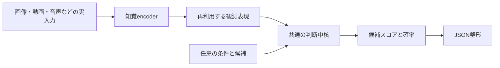

# 開発戦略：200M以内の条件付きOmni Decisionへ収束させる

2026-10-15、固定semantic fitと実画像由来状態の比較を完了した後の改訂。
ユーザーの「これまでを整理して戦略を組む」への回答を、実行結果で更新する。
画像比較の実行sourceは `1d6282753dc475ab02dd4e18fb57fc278ab1202a`。
旧[戦略・証拠集](STRATEGY_20261015.md)、各固定プロトコルと全成果物を保持する。
この文書は今後の優先順位であり、過去のselectorや実験の合否を変更しない。

## 今回の整理で決めること

参照状態は `41ebd8e21f3f302d19a47667466aa2aaaaef42b9`。リモートをfetchし、
この整理前のローカルと同じheadであることを確認した。
今回は戦略文書の更新であり、新しい学習・評価・モデル選択の実行結果は追加していない。

**主線はArchitecture Aを維持する。次は条件理解の一つの比較を完了し、実入力での転移を判定する。**
診断を増やし続けず、一つの構成について「条件理解・知覚・時間理解・共同入力・全体サイズ」をそろえる。
現時点では、200Mの限界、学習量不足、知覚encoderの限界のいずれも確定していない。

| 優先 | 次の成果物 | 判断・分岐 |
|---|---|---|
| 1 | 一つの候補構成の全パラメーター台帳と、必須課題／未知条件の評価表 | 語彙・埋め込み・headまで含めて200M以内か確認。部品小計だけで採用しない |
| 2 | 同じ独立データ・初期値・予算による、通常学習と条件関連性の補助教師信号の比較 | 新しい質問と候補表現への転移、旧能力の保持、確率品質を比較。新しいlossの優位性は未証明 |
| 3 | 選択した構成の実画像・音声・動画への接続比較 | 既存の観測済み診断は回帰確認として保持。新規の独立assetで品質を測る |
| 4 | 時間順序・状態変化・両入力が必要な判断を含む統合候補 | 意味的に正解が変わる対照で入力利用を確認。単独入力対照と未知sceneで測る |
| 5 | 同一候補のローカル実行、校正、8bit／4bit、固定最終評価 | 各課題の品質・全パラメーター・容量・遅延を同じ構成で満たした場合に採用 |

これは実行順序であり、数値閾値や学習設定を確定した実験プロトコルではない。
優先2は最大一組の比較を先に固定し、その結果と優先3を読むまで、補助loss・文面・seedの派生探索を増やさない。
改善がなければ、同じデータでさらに回す判断を避け、教師信号か中核の事前学習目的を再検討する。
優先4は最終完成の必須工程であり、条件理解だけの高得点で代替しない。

再現・漏洩検査は共通基盤として使い回す。通常の各実験には必要な整合性検査とsave/reloadを行い、
全件の別process再実行や独立数値監査は、既存の固定プロトコルで必須の場合と、
数値経路を変更した場合・結果が採否を変える場合に重点配分する。既に約束した検証は省かない。
テスト数や監査件数をモデル品質の進捗に数えない。

## 1. 目標と現在地

**量子化前の全推論パラメーター200M以下で、テキスト・画像・音声・動画から、
指定した候補の確率をJSONで返すOmni Decisionモデル**を作る。
同じ観測を複数の判断へ再利用し、条件なしの直接判定と、条件付きの判断を扱う。
ユーザー確認済みの必須入力はこの四つで、センサーは任意。画面は画像経路の応用として別途管理する。
ROADMAP上の画面・センサー研究は未達を明記して保持するが、追加センサー探索を主線の前提にしない。
下記195.37Mの部品小計にはセンサー経路や全融合層は含まれていない。

最初の実用軸は、ローカル自動化の前段となる**条件付きの状態・イベント判定**とする。
対象・数・比較・順序・状態変化・音と映像の対応を、候補や条件を差し替えて判断する。
用途の具体化は、成功を測れるようにするためである。難しい課題を完成条件から外さない。

95%以上、98%を目指す目標は、事前固定した各必須課題と未知条件で確認する。
平均値で弱い課題を隠さず、未知の任意問題で95–98%を保証するとは説明しない。
現在はR2の品質研究段階。実行・保存・JSON等の基盤はあるが、完成モデルはまだない。
テスト数、実験数、保存ファイル数から完成率を算出しない。

## 2. これまでで分かったこと

以下は異なる開発課題の値であり、一つのモデルの統一品質表ではない。

| 証拠 | 分かること | まだ言えないこと |
|---|---|---|
| 生入力、特徴再利用、JSON、保存・reloadを実行済み | 実験基盤を再利用できる | 四モダリティの高品質な統合製品が完成した |
| 直近fitは18,432問を一度ずつ消費し、1,024 optimizer calls完了 | 固定レシピを実機で測定した | 学習量だけが唯一の問題だった |
| 限定した条件理解24.22%→100%、数値判断24.46%→75.59% | 判断中核には学習による改善がある | 自由な自然言語、画像、動画でも100%になる |
| 31区分macro Accuracy28.72%→85.26%、最弱区分37.89% | 大きな改善と弱点が共存する | 平均85%を四モダリティの精度と呼べる |
| 全学習checkpointが保持条件不合格、選択はstep0 | endpointをそのまま採用できない | 改善が存在しなかった、または全て忘却だった |
| 同じ256画像の状態比較はoracle41.80%→73.83%、画像予測41.11%→73.34% | 固定学習の改善がこの実入力由来interfaceにも現れる | 独立した実画像品質が73%以上になった |
| 正しい状態でも数の質問0/256、誤答268件は全て別属性を選択 | 条件と属性の結び付きが具体的な障害として残る | 画像知覚が十分、または語句一つの追加で直る |
| 画像集計91.94%、数え上げ70.51% | 課題別に弱点が異なる | 自然画像全般で95%以上になる |
| 動画の空間・時間判断38.91%、条件変更ペア両問正解0/127 | 現在の動画経路は不十分 | encoderの能力限界が確定した |
| AV対応付けはrandom候補94.85%、hard候補84.08% | 難しい候補で評価する必要がある | 簡単な候補の高得点で共同理解が成立した |
| 別の共同分類は99.53%でも映像取り違えで回答不変 | 片側だけで解ける可能性を対照で見抜ける | 高得点が融合の有効性を証明した |

根拠：[直近学習の全結果](R2_DECISION_SEMANTIC_FIT_RESULTS_20261015.md)、
[実画像由来状態への接続比較](R2_SEMANTIC_NATIVE_RESULTS_20261015.md)、
[画像](R2_AFFINE_REGULARIZATION_RESULTS_20261012.md)、
[動画](R2_SPATIAL_READOUT_RESULTS_20261014.md)、
[AV対応付け](R2_LOMBARD_CORRESPONDENCE_RESULTS_20261015.md)、
[共同分類の診断](R2_LOMBARD_VISUAL_STATE_RESULTS_20261015.md)。

直近学習は別processのselected replayと独立CPU検証もPASS。
selected=0と研究前進条件FAILを保持し、学習済み1024は原因診断用に保存する。
768→1024ではAccuracyが上がる一方、macro NLL/Brier/ECEは悪化した。
さらに回せば全部改善するとは判断しない。

## 3. アーキテクチャの方針

| 選択肢 | 優先順位 | 進める条件 |
|---|---|---|
| A：既存の知覚encoder＋共通の判断中核＋小さな接続部分 | **主線を継続** | 実測済み部品を使い、誤りの発生箇所を分離できる |
| B：共有Transformerとモダリティ別入力層 | 次の候補 | Aの品質に必要な部品が200Mに収まらない、または接続が明確な障害と分かった場合 |
| C：互換モデルの整列・重み統合 | 後順位 | 互換性と品質保持を確認でき、実測コストの改善が期待できる場合 |

Aは全encoderを永久に凍結する方針ではない。問題のある経路に限定した適応を、必要な証拠の後で比較する。
重み共有だけで判断能力が上がるとは仮定しない。異なる重みを無条件に平均化しない。
巨大Teacherの再学習、全面蒸留、ternary QATの再開は現在の主線に追加しない。

JSONは通常のコードで整形する。排他的な多択と独立したyes/noを同じAPIで扱い、
自由文章生成をJSON出力のためだけに学習しない。
排他的な候補間の確率分布と、複数の独立条件のyes/no確率は別の意味としてschemaで区別する。
yes/noだけに絞ることが、backboneのパラメーター数を大幅に減らす根拠にはならない。
汎用性は「固定ラベルのheadを増やした数」ではなく、未知の条件・候補説明・組合せへの転移で測る。
正解状態やTop1属性列は診断手段であり、全モダリティを必ず文章へ変換する製品仕様ではない。
凍結encoder＋軽量な適応は[VideoPrism公式実装](https://github.com/google-deepmind/videoprism)にもある。
外部ベンチマークを今回の条件・時間判断の成績に転用しない。

## 4. 次に完了させる三つの仕事

### ① 完了：同じ判断の「正しい状態」と「画像由来の状態」を比較

**固定重み比較、全件fresh replay、独立検証まで完了。**
26payloadが完全一致し、20,480件の保存予測と指標・bootstrapを別実装で再計算した。
Windows事前確認の失敗も保存し、入力・重み・数値条件を変えずに修正した。

- 既存の観測済みTRAIN画像256枚、同じ1,024問・40候補を保つ。
- step0と学習済み固定1024 endpointを比較する。selected0はstep0と同一であり、別の成功候補に見せない。
- 正解状態、既存画像headが予測した状態、状態なし、質問なし、別画像の状態を比較する。
- 全体・項目別Accuracy/NLL/Brier/ECE、条件変更への反応、誤りの重なりを保存する。
- 既存の検証済み画像特徴を使うため、fresh画像encoder実行や独立した製品評価とは呼ばない。
- Top1属性に落とす情報損失と、知覚自体の誤りを混同しない。

| 結果 | 次の変更対象 |
|---|---|
| 正しい状態でも失敗 | 条件表現・数値判断・候補選択を改善。画像encoder大型化の根拠にはならない |
| 正しい状態で成功、予測状態で失敗 | 保存済み知覚予測とTop1変換を調べ、知覚headまたは接続を一つだけ変更 |
| 両方で成功、入力取り違えにも適切に反応 | 独立scene/source上の実入力課題へ進む |
| 高得点でも入力なし・取り違えで同じ | shortcutを除く課題・分割を先に直す |

この比較だけでencoderに必要情報が存在しないとは証明できない。
同じ256画像に対するprompt、checkpoint、係数の探索には戻らない。

実測は最初の分岐に該当する。正しい状態の268誤答は、数→質感160、数→形96、色→質感12。
正しいfield内だけに候補を制限すれば100%でも、その制限を製品の成功指標には使わない。
画像headの数え上げは78.91%で、54件の知覚誤りが下流の数の質問の失敗に隠れている。
条件と属性の結び付きを主な次の改善対象とし、知覚側の課題も未解決として残す。

### ② 次の改善は一つに絞り、校正を独立した工程にする

次は、自然な質問・候補説明・正しいが無関係な候補を含む、条件と属性の結び付きへの教師信号を検討する。
一つの新しい学習仮説として、独立データと同じinterfaceの保持・校正・転移条件を先に固定する。
質問の言い回しと候補の表現の影響は区別し、観測済みの数の質問一つを直して一般化と呼ばない。
具体案は、通常の正解候補CEと「その候補が質問に関係するか」という補助教師信号の有無を、
同じ新規データ上で比較すること。データ変更とloss変更の効果を混同しない。
旧MiniLMの条件対照loss比較は失敗として保持し、今回の教師ラベル・目的関数との違いを事前に明記する。
全40候補、正しいが無関係な候補、数値比較、旧能力の評価を保持する。
正解fieldでの候補削減、私的task IDでの分岐、正解状態を製品入力へ混ぜる実装は使わない。
新規の独立状態を使っても、過去の失敗を踏まえた開発である。新しい盲検成功とは呼ばない。
既に閉じたprompt/factorization探索を、根拠なく繰り返さない。
数値判断や物体数の誤答は、確率調整だけでは直らない。

現在のECE違反には自信不足と過信が混在する。512時点では全違反がECEだが、1024では
旧count課題のNLL/Brierも悪化している。これを一括して壊滅的忘却と呼ばない。

将来、確率校正を比較するなら、選択用validationとは別の校正用データを事前確保し、
固定候補について未校正と校正後を報告する。単一temperatureは低コストな候補だが、
ランキングの誤りや課題ごとの反対向きの歪みを全て修正する保証はない。
[校正の一次研究](https://proceedings.mlr.press/v70/guo17a.html)は方法の根拠であり、今回の成功の根拠ではない。

既存selector・合否は凍結したまま。観測済みvalidationへtemperatureを合わせて過去runを合格にしない。
新方針は新プロトコルとして検証する。未使用transferやsealed auditを校正・再選択に使わない。

### ③ 一つの候補で必須課題を通し、サイズと品質を同時に確定する

部品ごとの良い数値を集める段階から、同じ一つの構成を全課題で測る段階へ移る。
最低限の課題表は次の通り。合成データは診断・補助学習に使い、実入力評価を置き換えない。

| 経路 | 必須能力 | shortcut・汎化の確認 |
|---|---|---|
| Text | 条件指定、否定、数値比較、候補説明 | 未知表現・候補順・独立状態。日本語を含む対応言語を明示 |
| Image | 対象、数、属性、関係 | 独立画像・実画像、画像取り違え、条件変更 |
| Audio | 発話の意味、環境音、必要なら音の順序 | speaker/source分離、hard negative、無音・他音源 |
| Video | 前後関係、状態変化、対象の持続 | 同じフレーム集合の順序変更、独立scene、静止画対照 |
| Joint | 両入力に別々の必要情報がある判断 | 同じ問題上の最良単独入力、片側欠損、対応ずれ |
| Sensor / screen | ROADMAPの型・時間・欠損を扱う判断 | 未確認のまま省略せず、入力・サイズ・品質を別記 |

公開データは利用許可、同期、source単位の分割、必要情報を確認してから採用する。
metadata調査だけを品質実験として数えない。最初は成立する一つの共同課題を完了させる。
単独入力で十分な課題は単独経路の評価として残し、融合の利益を無理に主張しない。

各必須課題でAccuracy/NLL/Brier/ECE、件数、独立asset数、不確かさを記録する。
保留を導入する場合も全件Accuracyと回答率を併記する。
未知scene・条件・組合せを保った最終評価を用意し、選択と最終報告を分離する。
95%／98%の達成は問題数だけで判断せず、独立source数と区間を併記する。
例えば同一speakerやsceneから何百問作っても、同数の独立事例を集めたことにはならない。
保留で難問を除いた精度、容易な候補だけの精度、平均値での達成に置き換えない。

## 5. サイズの判断は後回しにしない

現候補の部品小計は次の通り。製品選定の確定値ではない。

| 部品 | パラメーター |
|---|---:|
| DeBERTa判断中核 | 70,830,722 |
| VideoPrism画像・動画 | 114,365,184 |
| Whisper encoderのみ | 8,208,384 |
| 環境音経路 | 1,961,239 |
| 小計 | **195,365,529** |
| 200Mまで残る量 | **4,634,471** |

音声encoder単独での必要品質は未証明。全head・融合・センサー等の余地も小さい。
Whisper全体を残す場合は小計224,917,785となり、制約を超える。
研究用DeBERTaを先に製品採用し、残りを帳尻合わせで削る順序にはしない。

①で判断中核の価値を測った後、必要な音声経路を含む完全構成で200Mを満たせるか判定する。
満たせなければ、品質が測れた部品を基準に一経路の小型化・共有化を比較する。
一部をoffloadするだけで、必要な全モデルのパラメーター数を小さく見せない。
この台帳を次のfitの前に作る。既存の122.79M AV経路は狭い対応付け課題で動いた参照であり、
音声encoderだけで自由な発話意味理解が成立した証拠ではない。
日本語対応に別の言語encoderが必要なら、その追加も全体へ計上する。

圧縮は品質が成立した候補に対して8bit、必要なら4bitを先に比較し、ternaryはその後の任意比較とする。
**200Mは量子化前の重み数、200MBは別の保存容量目標。**
量子化後も同じ必須課題で品質・速度・RAM/VRAMを測る。

## 6. 研究を収束させるルール

1. 同時に進める主な品質仮説は一つ。各比較は結果によって何を変えるかを先に書く。
2. 閉じたlabel/prompt方式、条件対照loss、固定factorization、AV係数、少数動画headの探索は、
   新しい原因・情報・独立データなしに再開しない。
3. 同じ仮説の二つの事前固定比較で前進しなければ、その経路を閉じる。モデル系列全体の限界とは一般化しない。
4. 合成スコアだけの新しい改善実験を追加する前に、対応する実入力との隔たりを確認する。今回の比較は完了。
5. 学習runの実行PASS、研究仮説の支持、製品採用の三つを別々に報告する。
6. CI・ハッシュ・再現は必要な信頼性確認。品質改善や製品完成の代用にしない。
7. 既存成果物、凍結selector、未使用transfer、sealed auditを保護する。ローカル計算のみ。
8. 文書には最新の判断と根拠へのリンクを置き、履歴の長さで現状が分からなくならないようにする。

**固定semantic fitと同じ判断の実画像比較は完了。次の一要因は条件と属性の結び付きへの教師信号。**
その独立データ・保持・転移条件は未確定で、追加学習は未実施。モデル昇格・量子化も行っていない。
