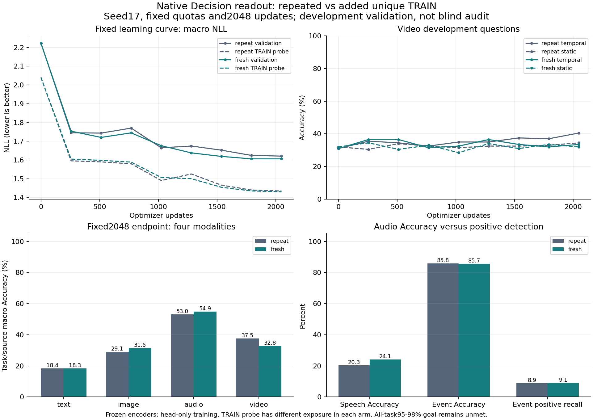

# 既存例の反復と未使用TRAIN例追加：同予算比較

## 実行と判定

両条件とも新規初期化から2,048更新を完了し、best/finalの全validation・TRAIN probe、
最終重みのTRAIN union・状態ペアを別processで完全再現した。実行はPASS。
95–98%の品質目標、条件・時間・共同入力・OOD・校正・圧縮の製品要件は未達のまま。

[事前固定プロトコル](R2_NATIVE_COVERAGE_PROTOCOL_20261016.md)・
[全source/task指標・実行引数・hash](R2_NATIVE_COVERAGE_RESULTS_20261016.json)。

## 固定2,048更新の同条件比較

値はtask→source→modalityのmacro。負例多数の音イベントAccuracyを認識能力と混同しない。

| 条件 | modality | Accuracy | NLL | Brier | ECE |
| --- | --- | ---: | ---: | ---: | ---: |
| repeat | text | 18.44% | 2.05356 | 0.83962 | 0.08570 |
| repeat | image | 29.05% | 1.93636 | 0.79510 | 0.11778 |
| repeat | audio | 53.03% | 1.17089 | 0.52934 | 0.07080 |
| repeat | video | 37.50% | 1.32143 | 0.69121 | 0.07478 |
| fresh | text | 18.33% | 2.02203 | 0.83588 | 0.07669 |
| fresh | image | 31.54% | 1.90749 | 0.78437 | 0.10979 |
| fresh | audio | 54.92% | 1.16790 | 0.52487 | 0.07900 |
| fresh | video | 32.75% | 1.32550 | 0.69470 | 0.07646 |

| 条件/重み | step | macro Accuracy | macro NLL | 最小task Accuracy |
| --- | ---: | ---: | ---: | ---: |
| repeat/selected | 2048 | 34.51% | 1.62056 | 0.00% |
| repeat/final | 2048 | 34.51% | 1.62056 | 0.00% |
| fresh/selected | 2048 | 34.39% | 1.60573 | 0.00% |
| fresh/final | 2048 | 34.39% | 1.60573 | 0.00% |

事前登録した研究上の判定（製品品質の合格条件ではない）：

- `macro_nll_lower`: PASS
- `macro_accuracy_higher`: FAIL
- `no_material_modality_regression`: FAIL

未使用例追加が有用という今回の固定規則：**混在、採用見送り**。
単一seed・既観測development validation内の結果であり、唯一の原因や将来の能力限界を示さない。
Image・Audioの改善は保存する。macro Accuracyは34.51→34.39%、NLLは1.62056→1.60573。
Video Accuracyの4.75pp低下が事前固定した2ppの保持幅を超えた。両条件の最良stepは結果として
2,048だったが、最終stepを自動選択したものではない。

STARSSは両条件ともspeech以外の10種類で正例recall0。water tapはvalidation正例0でrecall未定義。
speechはrepeatでrecall97.43%/specificity5.71%、freshで100%/0%と、ほぼ常に肯定する。
イベント全体の85%台Accuracyを有用な検出性能と呼ばない。音声の総合改善にもこの制約が残る。

## 学習曲線

| 条件 | step | macro Accuracy | macro NLL | Video Accuracy | temporal Video Accuracy | best step |
| --- | ---: | ---: | ---: | ---: | ---: | ---: |
| repeat | 0 | 15.91% | 2.22273 | 31.50% | 31.00% | 0 |
| repeat | 256 | 27.98% | 1.74492 | 33.00% | 35.50% | 256 |
| repeat | 512 | 28.49% | 1.74338 | 34.25% | 34.50% | 512 |
| repeat | 768 | 29.52% | 1.76991 | 32.50% | 32.50% | 512 |
| repeat | 1024 | 30.63% | 1.66487 | 33.25% | 35.00% | 1024 |
| repeat | 1280 | 32.74% | 1.67426 | 33.75% | 35.00% | 1024 |
| repeat | 1536 | 33.19% | 1.65226 | 35.00% | 37.50% | 1536 |
| repeat | 1792 | 33.87% | 1.62423 | 35.00% | 37.00% | 1792 |
| repeat | 2048 | 34.51% | 1.62056 | 37.50% | 40.50% | 2048 |
| fresh | 0 | 15.91% | 2.22273 | 31.50% | 31.00% | 0 |
| fresh | 256 | 30.01% | 1.75356 | 35.50% | 36.50% | 256 |
| fresh | 512 | 29.49% | 1.72026 | 33.50% | 36.50% | 512 |
| fresh | 768 | 29.29% | 1.74456 | 32.25% | 31.50% | 512 |
| fresh | 1024 | 31.29% | 1.67614 | 30.50% | 32.50% | 1024 |
| fresh | 1280 | 32.91% | 1.63777 | 35.25% | 36.50% | 1280 |
| fresh | 1536 | 33.70% | 1.61892 | 32.25% | 33.50% | 1536 |
| fresh | 1792 | 34.19% | 1.60591 | 32.75% | 32.00% | 1792 |
| fresh | 2048 | 34.39% | 1.60573 | 32.75% | 33.50% | 2048 |

## 学習量と露出範囲

| 条件/時点 | 消費回数 | unique questions | repeats | media assets | groups |
| --- | ---: | ---: | ---: | ---: | ---: |
| repeat/selected | 16384 | 6656 | 9728 | 3114 | 3382 |
| repeat/full | 16384 | 6656 | 9728 | 3114 | 3382 |
| fresh/selected | 16384 | 12800 | 3584 | 5385 | 5461 |
| fresh/full | 16384 | 12800 | 3584 | 5385 | 5461 |

両条件で各modality4,096回。同じsource/task/候補数の各位置quota・初期重み・LR系列・
全validation24,346問は一致する。freshは非Video各2,048問を未使用TRAINへ置換。
Videoは512問を両条件とも8回反復し、新しい動画問は0。ラベル比率や意味難度の一致は主張しない。
poolの元部分と追加部分はhashで混在するため、前半updatesが同一の二巡実験ではない。
元の1,024更新batch比較と比べると総期間・warmup・学習率履歴も変わるため、本比較の対照には使わない。

| 条件 | unique Text | unique Image | unique Audio | unique Video | TRAIN probe消費済み/全件 |
| --- | ---: | ---: | ---: | ---: | ---: |
| repeat | 2048 | 2048 | 2048 | 512 | 186/1456 |
| fresh | 4096 | 4096 | 4096 | 512 | 358/1456 |

固定TRAIN probeは大半が未消費であり、曲線のTRAIN/validation差を暗記と汎化の差として扱わない。

## 最終重みでのTRAIN到達度

同じ12,800問unionを両条件で評価。parent6,656問は両条件で学習し、additional6,144問はfreshだけが学習。
additionalはText/Image/Audioのみ。TRAIN unionやprobeはcheckpoint選択に使わない。

| 条件 | 評価subset | Text Accuracy | Image Accuracy | Audio Accuracy | Video Accuracy |
| --- | --- | ---: | ---: | ---: | ---: |
| repeat | parent | 28.57% | 33.98% | 57.91% | 42.58% |
| repeat | additional | 24.88% | 29.79% | 55.66% | 対象なし |
| repeat | consumed | 28.57% | 33.98% | 57.91% | 42.58% |
| fresh | parent | 24.00% | 31.74% | 60.01% | 46.68% |
| fresh | additional | 24.07% | 32.32% | 60.35% | 対象なし |
| fresh | consumed | 24.04% | 32.03% | 60.18% | 46.68% |

共通43taskだけのTRAIN/validation gapもJSONへ保存。TRAIN専用48・validation専用28taskは削除せず、
全71taskのvalidationを主評価に保持する。共通taskでも分布・正例率が違うため、因果的な過学習量とは呼ばない。

固定1,250状態ペアのstratumは`parent_consumed`/`parent_unconsumed`。今回の消費済みとは区別し、
各pairの両側が今回学習されたかを保存した。構成上選んだTRAIN診断であり、独立評価ではない。

| 条件 | parent consumed modality | 両問正解/ペア | 答え変更/ペア |
| --- | --- | ---: | ---: |
| repeat | text | 0/442 | 13/442 |
| repeat | image | 4/32 | 25/32 |
| repeat | audio | 2/88 | 14/88 |
| repeat | video | 0/16 | 0/16 |
| fresh | text | 1/442 | 42/442 |
| fresh | image | 6/32 | 22/32 |
| fresh | audio | 0/88 | 28/88 |
| fresh | video | 0/16 | 4/16 |

## Video差の不確かさ

保存予測をscene単位で対応付け、5,000回・seed17・percentile95%（linear quantile）で診断。
全Video400問/200scene、temporal200問。既観測validationと選択の影響を含み、盲検結果ではない。

| 固定終点のsubset | fresh−repeat Accuracy | 95%区間 | NLL差 | 95%区間 |
| --- | ---: | --- | ---: | --- |
| all | -4.75pp | [-8.50,-1.00]pp | +0.00407 | [-0.00687,0.01582] |
| temporal_descriptive | -7.00pp | [-12.00,-2.00]pp | +0.01314 | [-0.00553,0.03270] |

## 実行証拠と資源

実行source:`b3b7bb3abc4d27b6da51aa05032d2ff14704362f`、source CI #1835 success。
config:`configs/pretrained_reuse/native_unique_coverage_v1.json`、SHA256:
`47d697f3153fef0c8765510b85f3d725125067476a9a1fe7cf6b72069d8f2de5`。
初期値は元のseed17 readout、新規AdamW。warmup62/cosine2,048、1update8問、lr.001、
FP32/TF32無効。既存encoderは凍結し、追加パラメータ0。総数196,254,874、trainable889,345。
途中checkpoint・optimizer/RNGを保存するが、このrunnerにresume APIはなく厳密resumeとは主張しない。

| process | wall秒 | train秒 | eval秒 | peak CUDA bytes | receipt SHA256 |
| --- | ---: | ---: | ---: | ---: | --- |
| native-coverage-repeat-fit-01 | 638.65 | 114.24 | 500.45 | 209224704 | `18d0c407dc22650d2a67074a9e40052764925884a439827bceb2f4e643fc2528` |
| native-coverage-repeat-replay-01 | 165.69 | 0.00 | 143.36 | 155153408 | `e0ae94499f1e79015a77c04540644b8f595fd0cd5b4bb62fffff642a0ee81488` |
| native-coverage-repeat-smoke-01 | 26.65 | 1.84 | 6.17 | 209186816 | `031d60e3ea284b864e477b9200726dc7c924b799aa5a00c627bd3067bd175b10` |
| native-coverage-fresh-fit-01 | 665.71 | 118.00 | 521.57 | 209224192 | `44cec7447843ed54316633853c76f3e68fdcb45940b50c5da30c8bd56af90e1b` |
| native-coverage-fresh-replay-01 | 166.31 | 0.00 | 143.98 | 155153408 | `7e1e4df34f350b1261eb369bdc775c57779714e52b0c7b03313cb31b3f250e17` |
| native-coverage-fresh-smoke-01 | 27.73 | 1.91 | 6.24 | 209145856 | `4b49dd735017feebed26b8e648d58f6f255ff96999820cba75d5280dddd0c643` |

6processのwall合計1690.74秒。ローカルRTX3080 Laptop16GiB、クラウド費用0。
readoutのみの測定でencoder抽出時間を含まない。軽量CPU分析・manifest確認が一部並行し、
競合を排除したアーキテクチャ速度比較ではない。Python/Torch/CUDA等とUTC開始終了はJSONへ保存。

保存先:`C:/CodexArtifacts/pretrained-reuse-r2/native-coverage-{repeat,fresh}-{smoke,fit,replay}-01/`。
正確な全引数・effective config・LR/勾配/消費ID・評価配列・best/final hash・学習曲線を保持。
分析は`native-coverage-comparison-01/`、検証は`native-coverage-verification-01/`。
過去6成果物群168ファイルのhashを照合。実行sourceの物理byteをZIP保存し、CRLF差も再現できる。
旧Teacher/QAT/既存corpusとcheckpointは変更していない。sealed auditと校正データにはアクセスしない。

Plan01のstdout log hash不一致は事前receipt不備として保存。Plan02はopen logをpin対象から外し、
同一sample/plan bytesで検証を完了した。学習runの設定・データを途中変更したものではない。

7件のunused-row/枯渇/候補数quota/不正split・index・policy拒否テストを追加。
公開前Ruff PASS、全ローカルCPUテスト2,098 passed /1 skipped（29.98秒）、manifest25コマンドPASS。
実行後も既存168ファイルのhashが一致し、分析・plotのGit版は実行済みsourceとbyte単位で一致する。
公開commitのCI確認は検証ディレクトリの`publication-ci.json`へ別保存する。

## 次の判断

今回の未使用例追加は採用せず、両artifactと全予測を保持する。Videoの入力列と回数は同じでも、
他modalityのTRAIN例を変更するとVideoのTRAINは42.58→46.68%、validationは37.50→32.75%に
分かれた。共有判断部の最適化や汎化を調べる根拠になるが、永続的な忘却や容量限界の証明ではない。
両条件とも終盤までNLLが改善しているため、清潔なplateauが確定したとも主張しない。

次は、固定TRAINだけで共有判断部へのmodality別勾配を測り、共有パラメータ上での競合と
global clippingの影響を切り分ける。新しいvalidation探索、seed変更、予算延長はここから自動開始しない。
この診断は、modalityごとの小さな読出し分岐を比較するか、最適化条件を先に見直すかを決めるために使う。
一時的な勾配の逆向きだけで干渉を断定しない。実行前にcheckpoint・TRAIN IDs・測定回数・判断規則を固定する。

全推論パラメータ200M以下、四モダリティ・条件・時間・共同入力・OOD・各必須課題95–98%を維持する。
LSTM/xLSTMの拡張は、条件と観測の対応付けが成立し、時間メモリが必要という対照が得られてから判断する。
現時点ではxLSTM、encoder適応、量子化、製品昇格、sealed auditを新たに実行していない。
