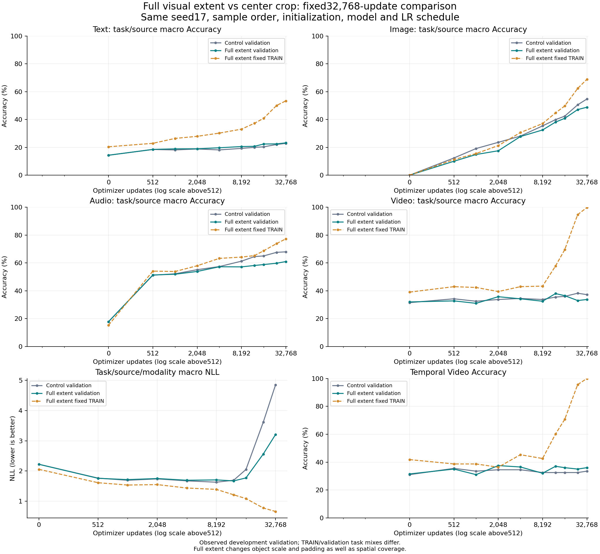

# Native full-extent preprocessing: measured comparison

**Execution: PASS. Product goal: incomplete.** One fixed seed17 run completed32,768 updates; fresh-process best/final prediction replay is bit-exact. This is observed development validation, not a blind audit.

## Measured interpretation

Executed on2026-10-16–17 JST. Preserve this candidate as a completed negative
research result; do not replace the original control or promote a product.

- Selected Image Accuracy35.4004→38.1348%, NLL1.798945→1.707391 and
  Brier0.735258→0.708370 improve. Its paired image Accuracy difference is
  +2.734pp, diagnostic95% interval[+0.977,+4.541].
- Selected Video Accuracy33.75→38.00%, but its interval[−0.75,+9.25]pp includes0.
  Video NLL worsens1.501657→1.691322. Temporal Accuracy's interval also includes0.
- Audio Accuracy61.2724→58.1766% declines3.096pp. Its NLL/ECE improve slightly;
  record the mixed trade-off rather than calling every Audio metric worse.
- Macro Accuracy37.4174→38.7589% improves while macro NLL1.630249→1.673511,
  Brier0.705674→0.717432 and ECE0.126081→0.135351 worsen. The predefined
  macro-NLL and nonvisual-retention checks fail.
- Equal8192-step macro Accuracy/NLL are both worse. At equal32768, NLL is lower
  but macro Accuracy is4.015pp lower; do not use endpoint NLL alone as success.
- After selected12288, TRAIN macro NLL falls to0.662113 while validation NLL
  rises to3.206027. Final Video TRAIN99.805% versus validation33.75%, and
  temporal TRAIN100% versus validation36%, show a large memorization gap.
  Full TRAIN/validation task mixes differ;43 shared-task results remain available.
  Overfitting warnings occur at8192/16384/24576/32768. These observations do not
  establish a general capability ceiling or rule out delayed learning elsewhere.

The audit identified real restrictions, but this one full-extent policy did not
solve the pipeline's quality problem. Restored extent, smaller object scale,
padding and joint optimization effects are not separately identified. The source
labels and all difficult validation examples remain unchanged.

### Next bounded question

The previous unique-coverage comparison ended at2048 updates, while longer curves
show continued changes. Next preregister one matched32768-update comparison using
the already-frozen fresh TRAIN pool against the original repeat control: same
original crop/features, model, seed17, LR schedule, validation IDs and selector;
only the TRAIN coverage policy changes. Keep the failed support and full-extent
policies out of that comparison. Record unique assets and class support, preserve
Video's limited256-scene coverage, and keep all modality trade-offs. This is not
yet run or scheduled by this report. Temporal/LSTM/xLSTM hypotheses remain open;
this result neither validates nor rules them out. No geometry/seed search or audit.

## Intervention and integrity

Replace only Image/Video resize-short-side/center-crop with bilinear full-extent fit into288x288 and centered black padding. Image640x480→288x216; Video480x320→288x192. Object scale is reduced and padding changes; these effects cannot be separated from restored spatial coverage by this comparison.

This registered comparison changes one shared visual preprocessing policy in both Image and Video. Because the readout is trained jointly, per-modality differences cannot isolate an Image-only versus Video-only causal contribution. Earlier audit suggestions to separate those routes are not claimed to have been completed by this combined policy experiment.

Keep original corpus/questions/targets/options,8 video frames, frozen encoder weights, queries, Text/Audio features,889,345-parameter readout, initialization, sampler, option permutations and32,768-update LR schedule. Total prequantization inference parameters196,254,874. No failed support policy, extra seeds, encoder tuning, calibration, sealed audit, quantization or product promotion.

Original-feature CPU smoke parity was bit-exact. All8,936 images and456 videos were extracted into new458 visual banks. Complete media hashes, observation indices, source pins and smoke/full parity passed. Sampler, LR plan, TRAIN probe and validation ID/options/target files are byte-identical to control. Initial Text/Audio validation logits match control exactly. All subsequent probabilities are raw temperature1 softmax.

Read-only upstream inspection confirms four temporal attention layers in the pinned VideoPrism base and interpolation of its16-frame temporal positional embeddings to8. The returned temporal/spatial tokens are retained; readout coordinates denote sampled order rather than physical synchronization. This comparison changes neither mechanism and does not test frame bandwidth or the incremental value of LSTM/xLSTM.

The first encoder smoke failed before extraction because the version recorder queried `tensorflow` instead of installed `tensorflow_cpu`. Only metadata-name handling changed; the failed receipt is retained. No dependency or experiment condition changed.

## Selected checkpoints

Control step8192; full-extent step12288. The unchanged hierarchical task/source/modality macro-NLL selector uses min_delta1e-5 and earliest tie, including step0. Final weights are kept separately.

| Model / modality | Accuracy (%) | NLL | Brier | ECE |
|---|---:|---:|---:|---:|
| Control / macro | 37.4174 | 1.630249 | 0.705674 | 0.126081 |
| Control / audio | 61.2724 | 1.098883 | 0.476619 | 0.111952 |
| Control / image | 35.4004 | 1.798945 | 0.735258 | 0.104247 |
| Control / text | 19.2469 | 2.121512 | 0.855259 | 0.091596 |
| Control / video | 33.7500 | 1.501657 | 0.755560 | 0.196529 |
| Full extent / macro | 38.7589 | 1.673511 | 0.717432 | 0.135351 |
| Full extent / audio | 58.1766 | 1.089665 | 0.483316 | 0.089183 |
| Full extent / image | 38.1348 | 1.707391 | 0.708370 | 0.095112 |
| Full extent / text | 20.7242 | 2.205668 | 0.877223 | 0.142178 |
| Full extent / video | 38.0000 | 1.691322 | 0.800821 | 0.214931 |

## Predefined research retention rule

Retain for further research: **False**.

- selected_macro_nll_improves: False
- mean_visual_accuracy_improves: True
- no_modality_declines_over_two_pp: False

This flag does not lower95–98% task gates. Every modality decline remains a measured trade-off, even if smaller than2pp.

## Full learning curve

| Step | Fixed TRAIN macro Acc (%) | Validation macro Acc (%) | Validation NLL | Image Acc (%) | Video Acc (%) | Temporal Video Acc (%) | Best step |
|---:|---:|---:|---:|---:|---:|---:|---:|
| 0 | 18.699 | 16.040 | 2.222634 | 0.000 | 32.000 | 31.500 | 0 |
| 512 | 32.804 | 28.161 | 1.759670 | 10.010 | 32.750 | 35.000 | 512 |
| 1024 | 34.538 | 29.161 | 1.715496 | 14.844 | 31.000 | 31.000 | 1024 |
| 2048 | 36.647 | 31.535 | 1.751918 | 17.529 | 35.750 | 37.500 | 1024 |
| 4096 | 41.768 | 34.731 | 1.694474 | 27.734 | 34.250 | 36.500 | 4096 |
| 8192 | 44.421 | 35.679 | 1.706152 | 32.471 | 32.500 | 32.000 | 4096 |
| 12288 | 51.269 | 38.759 | 1.673511 | 38.135 | 38.000 | 37.000 | 12288 |
| 16384 | 57.209 | 39.636 | 1.771517 | 40.820 | 36.500 | 36.000 | 12288 |
| 24576 | 70.252 | 40.598 | 2.561354 | 47.119 | 33.000 | 35.000 | 12288 |
| 32768 | 74.825 | 41.681 | 3.206027 | 48.779 | 33.750 | 36.000 | 12288 |

No performance early stopping. Rolling optimization metrics are not a fixed generalization gap. Full TRAIN/validation mixtures differ;43 shared-task gaps and every task/source/modality metric are retained in the JSON.

### Selected and equal-step differences (full extent minus control)

| Comparison | Macro Acc (pp) | Macro NLL | Text Acc (pp) | Image Acc (pp) | Audio Acc (pp) | Video Acc (pp) |
|---|---:|---:|---:|---:|---:|---:|
| selected | 1.341 | 0.043262 | 1.477 | 2.734 | -3.096 | 4.250 |
| equal8192 | -1.738 | 0.075903 | 1.315 | -2.930 | -4.089 | -1.250 |
| equal32768 | -4.015 | -1.642087 | 0.333 | -5.908 | -6.986 | -3.500 |

### Paired uncertainty at selected checkpoints

| Subset | Assets | Questions | Accuracy delta (pp),95% interval | NLL delta,95% interval |
|---|---:|---:|---|---|
| image | 512 | 2048 | 2.734 [0.977, 4.541] | -0.091554 [-0.120475, -0.062203] |
| video | 200 | 400 | 4.250 [-0.750, 9.250] | 0.189665 [0.075909, 0.304305] |
| video_temporal | 200 | 200 | 4.500 [-2.500, 12.000] | 0.160590 [-0.003133, 0.324575] |

Paired underlying-image/scene bootstrap,5,000 replicates,seed17,linear percentile95% intervals. All questions from an asset stay together. Brier intervals and equal-step contrasts are in JSON. Development reuse, multiple comparisons and checkpoint selection limit inference; intervals are diagnostic.

## Training consumption

- Whole run: 262,144 presentations; 6,656 unique questions; 255,488 repeats; 3,114 unique media assets; 3,382 groups.
- Selected checkpoint: 98,304 presentations; 6,656 unique questions; 91,648 repeats; 3,114 unique media assets; 3,382 groups.

Unique questions by source: `{"clevr4": 2048, "clevrer": 512, "lombard": 1024, "starss": 1024, "text:condition_relevance_v1": 683, "text:curriculum": 497, "text:original": 186, "text:programmatic_decision_v1": 682}`.

## Local resources and provenance

| Stage | Wall seconds | Train seconds | Evaluation seconds | Peak allocated CUDA bytes | Peak process bytes |
|---|---:|---:|---:|---:|---:|
| smoke | 86.506 | 1.925 | 34.197 | 209186816 | 2994368512 |
| fit | 2589.762 | 1818.418 | 684.766 | 209224704 | 3766013952 |
| replay | 221.251 | 0.000 | 167.328 | 155153408 | 3538362368 |
| Encoder failed_smoke | 6.885 | 0 | 0 | 0 | UNKNOWN |
| Encoder smoke | 26.217 | 0 | 0 | 0 | 4918243328 |
| Encoder full | 1595.079 | 0 | 0 | 0 | 4914466816 |

Total measured encoder/readout wall time 4525.701s (75.43min); cloud cost0. CPU encoder extraction uses the original JAX0.6.2/TF-CPU2.18.1 stack. Readout: NVIDIA GeForce RTX 3080 Laptop GPU, CUDA12.4, {"torch": "2.6.0+cu124", "numpy": "2.4.6", "psutil": "7.2.2"}, FP32, TF32disabled. Readout CUDA memory excludes frozen encoder end-to-end residency.

- Training source commit: `ce705f8087692358bf32ca86dfcbe0162b66564a`.
- Effective config SHA256: `d59429a49b63a4c835fb44630cb84d769935844ceeb19be6dc4fa81fd653cee2`.
- Visual cache receipt SHA256: `d61a11cc2b0810c48b17f9495c61059b89fb3ad7670d186b1fc5b553ce623a4f`.
- Control receipt SHA256: `645bedbe73ed508fad68c4f636a41df6c8630cd996641c44ce2a87d31550250b`.
- Protected prior artifacts checked unchanged: 434.

Exact commands, corpus/config/checkpoint/feature hashes, timestamps, all metrics, resource records and failure history are in the companion JSON and local receipts. Weights/media/large arrays remain outside Git. Best/final checkpoints include optimizer and RNG snapshots, but this runner has no validated resume path; exact replay is inference verification, not a claim of fully reproducible training resume.

## Interpretation and remaining work

Interpret the predefined retention result together with every modality, uncertainty and TRAIN/validation curve. Spatial cropping was a real information restriction; this comparison tests one full-extent policy, not every possible visual representation. Do not turn a negative result into a general model-capacity ceiling. Do not infer grokking solely from later Accuracy gains while NLL/calibration deteriorates. 

The broad objective remains incomplete:95–98% task quality, calibrated probabilities, native conditional/temporal/joint/OOD utility and deployable package/runtime must all be demonstrated. Current corpus has no synchronized audio/video joint decision. No further geometry/seed search, audit or product adoption is triggered automatically.

Local artifacts: `C:/CodexArtifacts/pretrained-reuse-r2/native-full-extent-*`. The existing Teacher/QAT artifacts, original control and failed support experiment are preserved.

## Verification and publication provenance

Training and fresh replay used immutable source `ce705f8`; its CI#1847 passed.
Pretraining Ruff,2170 CPU tests (1 skip) and25 manifest commands passed. All32
initial smoke/main updates have exactly matching CE/Accuracy/LR/gradient norms,
sample IDs and occurrence IDs. Final publication verification is recorded under
`native-full-extent-verification-01/publication/` and reported with the pushed commit.

The first report render had a string-join precedence error in its comparison
table. Preserve that `report.md` and executed generator; this publication helper
corrects only presentation and has a regression test. No metrics or checkpoints
were changed. The full private `comparison.json` remains immutable. The public JSON
keeps every candidate TRAIN/validation task/source/modality metric; redundant control
curves, endpoint TRAIN diagnostics and duplicate common-task detail are omitted and
referenced by the full result's SHA. Older control details remain in its own report.

Runtime context: Windows11 build26300, i7-12700H (14cores/20threads), driver616.92,
RTX3080 Laptop16GiB. Periodic lightweight CPU checks occurred; timings are observed
wall times, not an isolated hardware benchmark. Local electricity was not metered.
