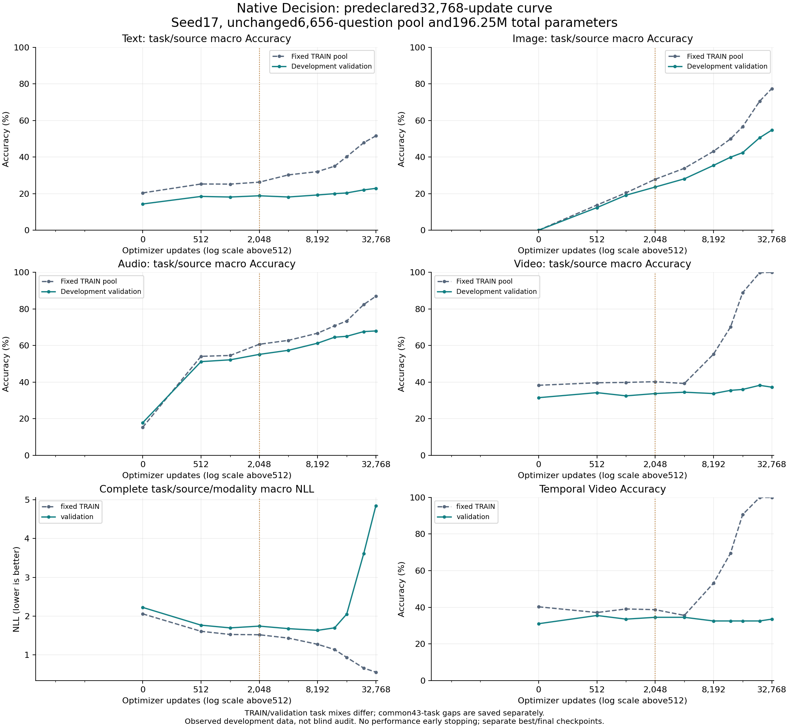
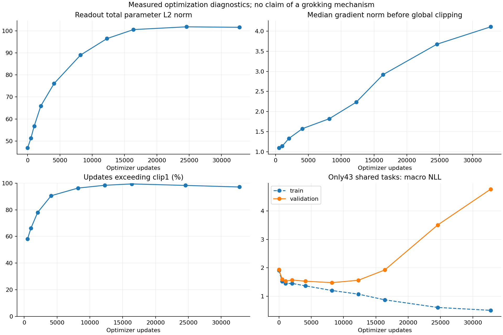

# Native Decision: 32,768-step learning curve (2026-10-16)

## Execution and scope

One seed 17 fit completed all 32,768 optimizer calls with the fixed repeat pool,
unchanged attention readout/frozen feature banks, fresh original initialization
and new optimizer. Full best/final inference exactly reproduced in a fresh
process. This is development validation, not a blind result or product promotion.

The user's delayed-learning correction changed the next priority from gradient
audit to a longer fixed curve. Historical 2,048 results remain intact. The new
cosine horizon changes early LR too; compare 2,048→32,768 WITHIN this run.
[Frozen protocol](R2_NATIVE_LONG_BUDGET_PROTOCOL_20261016.md).

## Learning curve

TRAIN is fixed inference on all 6,656 unique questions in the training pool;
early points include rows not yet consumed. Validation retains all 24,346 rows
and 71 tasks. Their task mixes differ; common 43-task results are also saved.
Rolling optimizer metrics are not a fixed generalization gap.

| Step | TRAIN macro Acc | Val macro Acc | Val macro NLL | Text | Image | Audio | Video | Temporal Video | Selected |
|---:|---:|---:|---:|---:|---:|---:|---:|---:|:---:|
| 0 | 18.50% | 15.91% | 2.22273 | 14.33% | 0.00% | 17.83% | 31.50% | 31.00% | True |
| 512 | 33.19% | 29.06% | 1.76454 | 18.46% | 12.35% | 51.20% | 34.25% | 35.50% | True |
| 1024 | 35.02% | 30.49% | 1.69382 | 18.14% | 19.14% | 52.19% | 32.50% | 33.50% | True |
| 2048 | 38.75% | 32.83% | 1.73962 | 18.81% | 23.58% | 55.16% | 33.75% | 34.50% | False |
| 4096 | 41.54% | 34.53% | 1.67458 | 18.16% | 28.08% | 57.40% | 34.50% | 34.50% | True |
| 8192 | 49.29% | 37.42% | 1.63025 | 19.25% | 35.40% | 61.27% | 33.75% | 32.50% | True |
| 12288 | 56.45% | 39.98% | 1.69525 | 19.97% | 39.89% | 64.55% | 35.50% | 32.50% | False |
| 16384 | 64.75% | 40.95% | 2.04963 | 20.37% | 42.38% | 65.05% | 36.00% | 32.50% | False |
| 24576 | 75.14% | 44.61% | 3.61509 | 22.03% | 50.54% | 67.61% | 38.25% | 32.50% | False |
| 32768 | 78.96% | 45.70% | 4.84811 | 22.87% | 54.69% | 67.98% | 37.25% | 33.50% | False |

## Fixed endpoint and selected checkpoint

| Checkpoint | Modality | Accuracy | NLL | Brier | ECE |
|---|---|---:|---:|---:|---:|
| Final32768 | text | 22.87% | 3.23330 | 0.96926 | 0.27394 |
| Final32768 | image | 54.69% | 1.94878 | 0.66872 | 0.23415 |
| Final32768 | audio | 67.98% | 1.39151 | 0.44993 | 0.16473 |
| Final32768 | video | 37.25% | 12.81887 | 1.17394 | 0.57350 |
| Selected8192 | text | 19.25% | 2.12151 | 0.85526 | 0.09160 |
| Selected8192 | image | 35.40% | 1.79894 | 0.73526 | 0.10425 |
| Selected8192 | audio | 61.27% | 1.09888 | 0.47662 | 0.11195 |
| Selected8192 | video | 33.75% | 1.50166 | 0.75556 | 0.19653 |

Selector remains hierarchical task/source/modality macro NLL, min_delta1e-5,
earliest tie and initial 0 eligible. No performance early stopping. All
scheduled checkpoints, best and final retained separately. No strict-resume
claim: optimizer/RNG are saved, but the runner has no resume API.

## Exposure and resources

| Scope | Presentations | Unique questions | Repeats | Media assets | Groups |
|---|---:|---:|---:|---:|---:|
| Whole run | 262144 | 6656 | 255488 | 3114 | 3382 |
| Selected8192 | 65536 | 6656 | 58880 | 3114 | 3382 |

| Process | Wall seconds | Train seconds | Evaluation seconds | Peak allocated CUDA bytes |
|---|---:|---:|---:|---:|
| smoke | 53.17 | 1.79 | 31.76 | 209186816 |
| fit | 2550.88 | 1822.59 | 682.02 | 209224704 |
| replay | 187.34 | 0.00 | 164.56 | 155153408 |

Total process-body wall:2791.40s; local RTX3080 Laptop only, cloud cost 0.
Frozen-feature readout measurements exclude previous encoder extraction.
Trainable:889,345; total before quantization:196,254,874.
No parameter increase. FP32, TF32 off, AdamW(.001,wd.01,clip1), warmup62,
cosine 32768. Final zero-LR call still consumes examples. Exact versions,
arguments, UTC start/end, LR vector and source/input hashes are in receipts.

## Paired Video uncertainty

Final minus this run's2,048 predictions, scene-cluster paired bootstrap,
5,000 resamples, seed 17, percentile 95% linear quantiles. Repeated development
inspection and checkpoint selection apply; these are not independent audit intervals.

| Subset | Accuracy difference | 95% interval | NLL difference | 95% interval |
|---|---:|---|---:|---|
| all | +3.50pp | [-2.00,9.00]pp | +11.37470 | [9.71100,13.06893] |
| temporal_descriptive | -1.00pp | [-10.00,7.50]pp | +11.79629 | [9.28433,14.44137] |

## Interpretation

**実行は完了。学習量増加の効果は指標によって異なる。** 同一runの2,048→32,768で
macro Accuracyは32.83→45.70%、Imageは23.58→54.69%、Audioは55.16→67.98%へ改善した。
短いrunだけで学習不足を除外したり、モデルの容量限界を決めたりする根拠はなかった。
この修正を今後の比較にも引き継ぐ。

一方、macro NLLは1.73962→4.84811、Brierは0.74777→0.81546、ECEは0.12282→0.31158に悪化。
最終点を採用せず、事前固定selectorが選んだ8,192 step（macro NLL1.63025）を保持する。
最高Accuracyのcheckpointを後から選び直してはいない。旧cosine2,048-runのmacro NLL1.62056よりも
今回のbestは低くない。旧runと新runは学習率の時間軸が異なるため、純粋なstep数の因果比較ではない。

**今回の範囲では、明確なグロッキングは確認できない。** Video TRAINは24,576で99.80%、
32,768で100%になったが、validationは38.25→37.25%、temporalは32.5→33.5%だった。
同一runの2,048 temporal34.5%からも改善していない。Video NLLは最終12.81887、ECE0.57350で、
誤答への過信が大きい。Text/Image/AudioのTRAIN最終Accuracyは51.55/77.39/86.91%であり、
全課題を暗記した後の遅延汎化という段階にも達していない。単一seed、疎な評価点、固定の有限予算なので、
さらに後の変化や別の最適化条件まで否定する結果ではない。

Audio全体の改善をイベント認識の完成と扱わない。selected8,192では非speechの10正例ありclassの
recallがすべて0。最終でもbell/clapping/instrument/knockは0、他の非speech recallは約5–19%にとどまる。
water tapはvalidation正例0でrecall未定義。全classの件数・recall・specificityをJSONへ保持した。
4モダリティの各必須課題95–98%は未達で、製品への昇格は行わない。

次の優先課題は、十分な学習予算を確保した上で過学習・過信を抑えること。まず同じ32,768-step計画で
正則化だけを変える対照を別途事前固定し、データ増加やLSTM/xLSTMと同時変更しない。
今回のweight norm増大は測定事実だが、weight decayが原因であるとの証明ではない。
Videoの256 TRAIN sceneという小さい独立asset数も次のデータ改善候補として残す。
LSTM/xLSTMは短期結果だけで棄却せず、将来比較する際は初期値・データ・長期予算・選択規則を揃える。
このreportでは追加seed、追加予算、正則化変更runは開始していない。

[Power et al.](https://arxiv.org/abs/2201.02177) and
[Omnigrok](https://arxiv.org/abs/2210.01117) motivate examining delayed
generalization; neither guarantees it for this architecture/data. Common-task
TRAIN/validation timelines and parameter norms are retained. A95% threshold
crossing on an imbalanced task is not proof of grokking or useful recognition.

## Reproducibility and protection

Training source:`8756a09f582554c0321ed5ece71846d6b19469cd` (CI #1839 success).
Effective config SHA256:`19e4a1f005856684950fb229a12d757768eb7369787ad08b40b3f85de2ba3e45`.
Config:`configs/pretrained_reuse/native_long_budget_v1.json`.
Runner:`scripts/train_native_long_budget.py`; analysis/plot scripts are published
from the exact executed bytes. Raw predictions/weights remain outside Git.

Artifacts:`C:/CodexArtifacts/pretrained-reuse-r2/native-long-budget-{smoke,fit,replay}-01/`.
Analysis:`native-long-budget-comparison-01/`; verification:`native-long-budget-verification-01/`.
All 288 pinned prior artifact files are unchanged. Old Teacher/QAT data
and weights were not modified. Sealed audit/calibration remained unopened.
Local preflight: Ruff PASS; 2,111 CPU tests passed / 1 skipped; 25 manifest commands PASS.
Publication adds a stable-log-softmax regression for extreme wrong confidence: 2,112 CPU tests passed / 1 skipped (30.23s), Ruff PASS.
The verification directory contains the executed-source ZIP and physical-byte hash manifest.
Original replay receipts require the recorded source bytes and absolute paths; current HEAD
adds analysis/tests. Preserve hash checks when restoring the recorded execution environment.
All four modalities and every required task95–98%, joint/temporal/OOD quality,
calibration and deployment gates remain open. No product model promoted.

## Source counts and immutable inputs

| Source | Unique TRAIN questions | Whole-run presentations | Selected presentations |
|---|---:|---:|---:|
| text:condition_relevance_v1 | 683 | 21856 | 5464 |
| text:programmatic_decision_v1 | 682 | 21824 | 5456 |
| text:curriculum | 497 | 15904 | 3976 |
| text:original | 186 | 5952 | 1488 |
| clevr4 | 2048 | 65536 | 16384 |
| lombard | 1024 | 32768 | 8192 |
| starss | 1024 | 32768 | 8192 |
| clevrer | 512 | 65536 | 16384 |

Training feature corpus hashes (existing files, unchanged):

- `banks.json`: `44ef5f26ffb01bd264c7283f82e6a6f37f1a4d3c34f522515ddfc7fc2acb6520`
- `observations.json`: `e82febae93455cc06a2fb31f3dcc83ebcb79328552aff2ec4da507d660186afb`
- `train.jsonl`: `d279ca44c6ff8e619529805be21675a8b4088fdcc476c7bb04649abdb5e60ebb`
- `validation.jsonl`: `1f545a6e8d10b2712980f9ada58a0e5eef5b21021e4e01d6483965889a970326`

Checkpoint SHA256:

- `initial.pt`: `3ce7f72450e16946b1fb113c3fa8793f1d6a59f2b6221564cff7b30feebfba1c`
- `best.pt`: `d7b666cd7ea60dcf236bd06e53b0107e0d5f74193824c1f4b44bbe4d5cdc1b56`
- `final.pt`: `3fdfc289d221a8c49e68aef6f23b6c518af40ce21d2fc320280c582a146261fb`

Optimization diagnostics show rising parameter norms and clipping frequency; they do not identify a cause.

The first plotting attempt lacked Matplotlib on the training PYTHONPATH. Rendering used the existing separate plotting dependencies without installation or a training-environment change; `plot-attempts.json` records both attempts.
