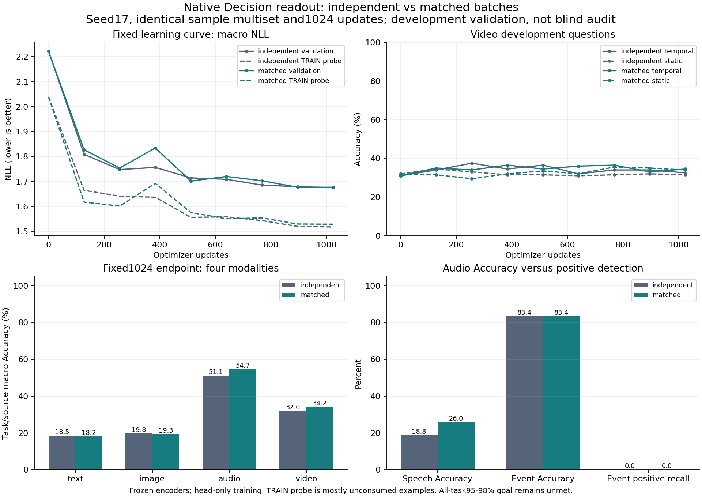

# 同じ入力集合でのbatch構成比較：実測結果

## 結論

**実行PASS、batch構成による状態対応の改善仮説は、この設計・予算では支持されなかった。**
通常batchと、同じ質問・全候補で異なる入力/正解を組にしたbatchを、各1,024更新まで実行した。
両方の最良・最終checkpoint、全validation予測、固定TRAIN診断の全予測が別processで完全一致した。
対応付け側はAudio/Video Accuracyを上げたが、Text/Image Accuracyは下がり、macro NLLも改善しない。
消費済みTextの両正答は2/442→1/442、Videoは両方0/16。製品採用しない。

これは単一seedの観測済み開発validation。時間的表現の能力限界やLSTM/xLSTMの無効性を示さない。
四モダリティ95–98%、joint/OOD、校正、量子化後の品質、実機packageの要件は未達で、R2は未完了。

## 実行条件

[事前固定プロトコル](R2_NATIVE_MATCHED_BATCH_PROTOCOL_20261016.md)と
[設定](../../configs/pretrained_reuse/native_matched_batch_fit_v1.json)に従った。
実行source `2f586bc2fb2259df6ad801bc8f3b7256ad24815b`。
config SHA-256 `e2b6827f0113aeb616f3d1926ff852ef527b5390ac4203729d579de9f1c6a788`。
全推論196,254,874パラメーター、判断層889,345のみ学習。Encoderは凍結特徴を使う。
新規LoRA、LSTM追加、Encoderの解凍、データ変更、sealed auditアクセスは行っていない。

元baselineの同じ8,192 sample occurrencesを使い、各方式で一回ずつ消費した。
unique6,656問、繰返し1,536回、観測5,107、media asset3,114、group3,382。
各modality2,048回。source/task別の全会計はJSONに保存。
異なる正解を持つ同条件pairは通常279組、対応付け2,505組/4,096組。
組にならない1,591組もfallbackとして保持し、困難な問題や候補を削除していない。

両方seed17、同じ元initial、AdamW .001、warmup31、cosine1,024更新、8microbatches/update。
原baselineの4microbatches/2,048更新とは別の比較。因果対照は今回の二方式であり、旧runとの差を
batchだけの効果とは呼ばない。CEは8例の平均で、pairwise lossは追加していない。
変更はbatch内の相関と入力順序。候補シャッフルは同じoccurrence IDに固定した。
最終更新のLRは0で、入力/勾配計算は行うが重みは変わらない。

## 同じ1,024更新での比較

全validation24,346問、元の47text区分と全候補を維持。表はtask→source→modalityのmacro。
Accuracyの単純な全件平均と混同しない。全体/各source/各taskの詳細はJSONに保存。

| 方式 | modality | Accuracy | NLL | Brier | ECE |
| --- | --- | --- | --- | --- | --- |
| independent | text | 18.51% | 2.02947 | 0.83497 | 0.06814 |
| independent | image | 19.82% | 2.16112 | 0.86301 | 0.06082 |
| independent | audio | 51.11% | 1.18959 | 0.55497 | 0.09384 |
| independent | video | 32.00% | 1.32134 | 0.69051 | 0.07603 |
| matched | text | 18.25% | 2.05960 | 0.84044 | 0.08106 |
| matched | image | 19.29% | 2.16380 | 0.86494 | 0.05210 |
| matched | audio | 54.68% | 1.15556 | 0.53994 | 0.11003 |
| matched | video | 34.25% | 1.32878 | 0.69399 | 0.04906 |

通常→対応付けのmacro Accuracyは30.3626%→31.6148%、macro NLLは1.675381→1.676937。
最弱modalityはText18.5130%→18.2470%、最低task Accuracyは両方0%。
STARSSのAccuracy83.3848%は両方all-noで、正例のある11クラスのrecallは全て0。
TRAIN bell正例0、validation water-tap正例0の不足は解消していない。
Audioの集計改善だけで音声認識・音理解の成功としない。

### 固定学習曲線

| 方式 | 更新 | macro Accuracy | macro NLL | 時間的Video Accuracy | best step |
| --- | --- | --- | --- | --- | --- |
| independent | 0 | 15.91% | 2.22273 | 31.00% | 0 |
| independent | 128 | 28.29% | 1.80878 | 34.00% | 128 |
| independent | 256 | 28.49% | 1.74785 | 37.50% | 256 |
| independent | 384 | 28.67% | 1.75645 | 34.50% | 256 |
| independent | 512 | 28.82% | 1.71447 | 36.50% | 512 |
| independent | 640 | 28.54% | 1.70876 | 32.00% | 640 |
| independent | 768 | 29.67% | 1.68556 | 34.00% | 768 |
| independent | 896 | 30.60% | 1.67911 | 34.00% | 896 |
| independent | 1024 | 30.36% | 1.67538 | 32.50% | 1024 |
| matched | 0 | 15.91% | 2.22273 | 31.00% | 0 |
| matched | 128 | 27.98% | 1.82721 | 35.00% | 128 |
| matched | 256 | 27.79% | 1.75403 | 34.00% | 256 |
| matched | 384 | 29.25% | 1.83434 | 36.50% | 256 |
| matched | 512 | 29.51% | 1.70161 | 34.50% | 512 |
| matched | 640 | 30.32% | 1.72012 | 36.00% | 512 |
| matched | 768 | 31.20% | 1.70280 | 36.50% | 512 |
| matched | 896 | 31.54% | 1.67683 | 33.00% | 896 |
| matched | 1024 | 31.61% | 1.67694 | 34.50% | 896 |

対応付け側の640ではTRAIN probe NLLが下がる一方validation NLLが上がる警告があった。
その後は再び改善するので、一点の警告だけで持続的過学習/収束限界と断定しない。
固定TRAIN probe1,456問のうち実際に消費したのは186問で、1,270問は未消費。
その差やrolling minibatch Accuracyを通常のTRAIN/validation汎化gapと呼ばない。

### validation選択と学習量を分離

| 方式 | 選択step | 選択時消費 | unique | 繰返し | macro Accuracy | macro NLL |
| --- | --- | --- | --- | --- | --- | --- |
| independent | 1024 | 8192 | 6656 | 1536 | 30.36% | 1.675381 |
| matched | 896 | 7168 | 5888 | 1280 | 31.54% | 1.676826 |

選択は階層macro NLL、min_delta1e-5、同点は早いstep、初期0も候補。通常は1,024、
対応付けは896が最良。対応付けは最終1,024の重みで896のbestを上書きしていない。
全runの消費は両方8,192回で、選択時点の7,168回と混同しない。

## 固定TRAINの状態対応診断

前回凍結した1,250組、2,500個の異なるquestion IDを、今回の固定終点で推論した。
同じ質問・全候補で観測と正解が異なる組。これは構成したTRAIN診断であり、独立testの精度ではない。

| 方式 | 区分 | pair数 | 両方正解 |
| --- | --- | --- | --- |
| independent | consumed:audio | 88 | 0/88 |
| independent | consumed:image | 32 | 0/32 |
| independent | consumed:text | 442 | 2/442 |
| independent | consumed:video | 16 | 0/16 |
| independent | unconsumed:audio | 136 | 0/136 |
| independent | unconsumed:image | 32 | 0/32 |
| independent | unconsumed:text | 504 | 2/504 |
| independent | unconsumed:video | 未測定 | 未測定 |
| matched | consumed:audio | 88 | 3/88 |
| matched | consumed:image | 32 | 0/32 |
| matched | consumed:text | 442 | 1/442 |
| matched | consumed:video | 16 | 0/16 |
| matched | unconsumed:audio | 136 | 5/136 |
| matched | unconsumed:image | 32 | 0/32 |
| matched | unconsumed:text | 504 | 1/504 |
| matched | unconsumed:video | 未測定 | 未測定 |

入力で予測が変わることと、両方が正しいことを区別する。対応付け側のImageは消費済みで
59.375%の組で予測が変わるが両正答0/32。Videoは両方式とも16組で回答変化0。
小さいVideo標本、17個のpair不成立task区分、unconsumed Video不在を保持する。
これらの数値はcheckpoint選択や追加学習に使っていない。

### 差の不確かさ

保存済みvalidation予測をscene単位で対応付けたbootstrap5,000回、seed17、
percentile95%（NumPy linear quantile）。matched−independentの固定終点差：

- Video全400問/200scene：Accuracy +2.25pp、区間[-2.50,+6.75]pp。
  NLL +0.007445、区間[-0.001675,+0.016757]。
- 時間的200問/200scene：Accuracy +2.00pp、区間[-4.00,+8.00]pp。
  NLL +0.002043、区間[-0.009911,+0.014518]。

いずれも0を含む。selection依存の区間もJSONに保存し、training seed変動を含む区間としない。
事前の改善条件はmacro NLL低下、消費済みText/Video両正答増加、許容幅内の他modality保持。
前3条件に不合格、保持条件だけ合格。効果は混在し、有用な状態対応の改善を支持しない。

## 計算費用と保存

RTX3080 Laptop16GiB、driver616.92、Python3.11.9、Torch2.6.0+cu124、NumPy2.4.6、
psutil7.2.2、FP32/TF32無効、既存環境を維持。下表はreadoutの測定であり、Encoder全常駐や
生mediaからJSONまでの遅延ではない。

| 方式 | 学習params | 更新秒 | 評価秒 | main wall秒 | peak CUDA bytes |
| --- | --- | --- | --- | --- | --- |
| independent | 889345 | 59.88 | 478.07 | 561.11 | 209214464 |
| matched | 889345 | 60.58 | 476.52 | 559.79 | 209223168 |

各方式32更新smokeと全best/final fresh replayを含む6process内wall合計
1437.97秒（23.97分）。import前起動、過去の特徴抽出、
CPU比較/図生成は含まない。軽いCPU検証を並行したため厳密な専有速度benchmarkではない。
クラウド費用0。peak working set等の全測定はJSONに保存。

成果物：`C:/CodexArtifacts/pretrained-reuse-r2/native-batch-{independent,matched}-{smoke,fit,replay}-01/`。
全更新履歴、最良/最終重み、全予測、入力/設定hash、正確な引数/時刻/環境を保存。
`native-matched-plan-01/`に全順序と候補permutation、`native-batch-comparison-01/`に全比較と図、
`native-batch-verification-01/`に独立会計検証、manifest結果、CI、物理byteを保持したsource ZIP。
source ZIPは改行形式を含む1,014ファイル/2,112,893bytesで、重み/mediaを含まない。
移動先でhash検査を外した再実行や厳密resumeを主張しない。

旧baseline/LSTM各36artifactと旧state診断5artifactのSHA-256を再照合し一致。
既存Teacher/QAT、旧config/corpus、OneDrive worktreeの未コミット変更を保護した。
モデル重み、media、大型checkpointはGitに追加していない。

## 次の判断とLSTMの位置付け

このbatch比較は終了し、条件・seed・予算を振り直して改善を探さない。
LSTM/xLSTMの拡大もこの結果だけでは正当化できない。次は同じ固定checkpointで、実際に
消費したTRAIN全件のtask別到達度を確認し、低い到達度が学習被覆、最適化、読出し構造の
どこにあるかを切り分ける。その結果で一つの変更を選ぶ。TRAIN probeの未消費を混ぜて
容量限界を決めたり、既存の不採用contrast/prompt探索を繰り返したりしない。

ユーザーの「時系列の状態を運ぶ部分」という構想は維持する。想定は
`native特徴 → 時刻付き状態更新 → 条件/候補による読出し → 確率JSON`。
現LSTMはclip内の固定空間位置/音声系列のresidualであり、object trackingや、
同期した複数streamをまたぐ永続状態の実装ではない。時間記憶の採否は、静的な値読出し、
時間順序/状態reset対照、同程度paramsの非再帰対照、他modality保持を測って決める。

[xLSTM論文](https://arxiv.org/abs/2405.04517)は拡張gateとscalar/matrix memoryを扱い、
[公式コード](https://github.com/NX-AI/xlstm)は公開されている。ただし本研究でxLSTMは
実行しておらず、200M Omni品質やWindows上の性能を論文から保証しない。
候補名に先に合わせず、必要な能力を示した構成を採る。

## 検証

新しいsamplerの回帰テスト9件、全CPU2,083 passed /1 skipped、Ruff PASS、manifest25件PASS。
実行sourceのGitHub Actions #1827 success。公開commitのCIはpush後に確認し別receiptに保存する。
全18評価点のmetrics、selector履歴、全2,048更新の実ID/occurrence/LR、初期予測一致、
選択/全run会計、両best/finalと全診断のfresh replayを独立スクリプトで検証した。
