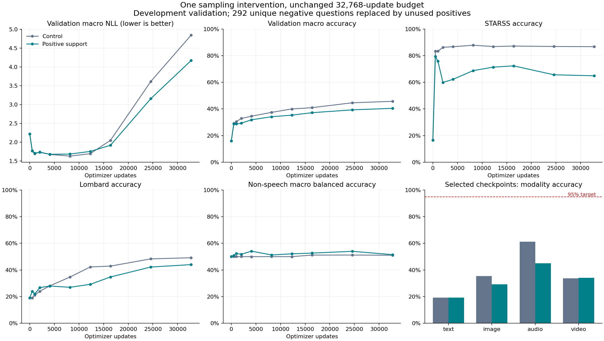
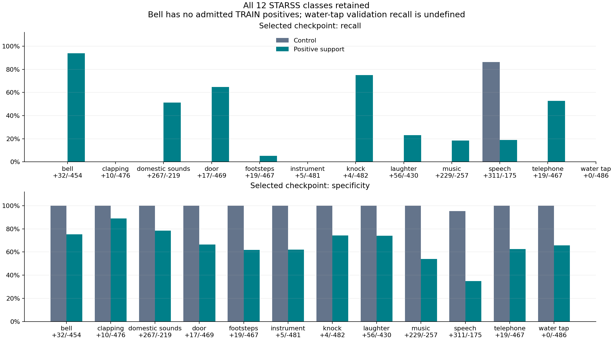

# Native Decision: positive-support comparison (2026-10-16)

## Question and execution

The pipeline audit found that available TRAIN positives were absent from the
actual consumed STARSS subset. This experiment tests one predefined repair
at the same long budget; it does not assume more positive examples must help.
One fresh seed17 run completed32,768 updates and all scheduled validations.
Best/final predictions and the original control predictions on its TRAIN
subset reproduced bit-exactly in a separate process. No product promotion.
[Pre-registered protocol](R2_NATIVE_SUPPORT_PROTOCOL_20261016.md).

## Fixed comparison

Same frozen encoders/features, native readout889,345 parameters, total
196,254,874 parameters before quantization. Same initial weights, AdamW,
LR0.001, warmup62, cosine32,768, weight decay0.01, gradient clip1, eight
microbatches/update, option-shuffle rule and full24,346-question validation.
No early stop. Selector remains task/source/modality macro NLL, min_delta1e-5,
earliest ties and initial0 eligible. No architecture/frame/crop change.

Only292 unique negative STARSS rows are replaced with unused positive TRAIN
rows of the same question/candidate condition. Each replacement retains its
32 occurrence slots:9,344 presentations change; all229,376 non-STARSS slots
are identical. Total6,656 unique questions and262,144 presentations stay fixed.
STARSS positive unique support rises110→402 out of1,024 questions. Preserve
all original positives, including speech70/85. Candidate shuffle still hashes
row identity, so replaced rows use their own original-rule permutations.

This intervention combines positive support, recording diversity and label
prior changes. It cannot isolate these effects from one another. The floor
is an engineering choice, not an optimized ratio. No validation labels chose
replacement questions. No rare class or difficult validation example was removed.

| Event | Unique quota | Positive before | Positive after | Available TRAIN positives | Positive recordings after | Positive rooms after |
|---|---:|---:|---:|---:|---:|---:|
| bell | 86 | 0 | 0 | 0 | 0 | 0 |
| clapping | 86 | 0 | 9 | 9 | 6 | 3 |
| domestic sounds | 86 | 10 | 43 | 249 | 10 | 4 |
| door | 86 | 6 | 43 | 60 | 22 | 6 |
| footsteps | 85 | 3 | 43 | 105 | 30 | 6 |
| instrument | 85 | 1 | 43 | 73 | 3 | 1 |
| knock | 85 | 0 | 10 | 10 | 7 | 3 |
| laughter | 85 | 6 | 43 | 273 | 34 | 6 |
| music | 85 | 14 | 43 | 339 | 11 | 5 |
| speech | 85 | 70 | 70 | 1631 | 37 | 6 |
| telephone | 85 | 0 | 27 | 27 | 11 | 4 |
| water tap | 85 | 0 | 28 | 28 | 6 | 2 |

Bell remains unsupported in admitted TRAIN. Water tap has no positive
validation examples. Neither limitation is hidden by aggregate Accuracy.

## Full learning curve

TRAIN probe covers all6,656 candidate-consumed questions; its membership
differs from control for STARSS, so the two TRAIN means are not a
matched-question comparison. Separate6,948-question union results are saved.

| Step | TRAIN macro Acc | Val macro Acc | Val macro NLL | Text | Image | Audio | Video | Non-speech balanced Acc | Best step |
|---:|---:|---:|---:|---:|---:|---:|---:|---:|---:|
| 0 | 22.07% | 15.91% | 2.22273 | 14.33% | 0.00% | 17.83% | 31.50% | 50.00% | 0 |
| 512 | 30.44% | 28.82% | 1.77111 | 18.43% | 11.13% | 51.70% | 34.00% | 50.87% | 512 |
| 1024 | 32.54% | 28.71% | 1.71072 | 17.90% | 16.31% | 48.90% | 31.75% | 52.28% | 1024 |
| 2048 | 35.50% | 29.30% | 1.73094 | 18.00% | 23.39% | 43.31% | 32.50% | 51.79% | 1024 |
| 4096 | 38.10% | 31.84% | 1.67865 | 19.14% | 29.15% | 45.06% | 34.00% | 54.11% | 4096 |
| 8192 | 44.42% | 34.14% | 1.68502 | 19.40% | 34.77% | 47.88% | 34.50% | 51.27% | 4096 |
| 12288 | 48.62% | 35.31% | 1.75505 | 19.01% | 38.18% | 50.30% | 33.75% | 52.10% | 4096 |
| 16384 | 57.29% | 37.16% | 1.91778 | 18.82% | 41.80% | 53.53% | 34.50% | 52.66% | 4096 |
| 24576 | 71.83% | 39.31% | 3.15813 | 20.32% | 48.73% | 53.92% | 34.25% | 53.98% | 4096 |
| 32768 | 76.93% | 40.44% | 4.17349 | 20.74% | 53.32% | 54.44% | 33.25% | 51.47% | 4096 |



## Selected and equal-budget comparisons

The selected comparison uses each run's unchanged macro-NLL rule, not
the checkpoint with the best STARSS or aggregate Accuracy. Equal-budget
8,192 and32,768 points are predeclared secondary comparisons.

| Contrast | Control step | Candidate step | Macro NLL control → candidate | Macro Acc control → candidate | Non-speech balanced Acc control → candidate |
|---|---:|---:|---|---|---|
| selected | 8192 | 4096 | 1.63025 → 1.67865 | 37.42% → 31.84% | 50.00% → 54.11% |
| equal8192 | 8192 | 8192 | 1.63025 → 1.68502 | 37.42% → 34.14% | 50.00% → 51.27% |
| equal32768 | 32768 | 32768 | 4.84811 → 4.17349 | 45.70% → 40.44% | 51.05% → 51.47% |

| Checkpoint | Modality | Accuracy | NLL | Brier | ECE |
|---|---|---:|---:|---:|---:|
| Control selected8192 | text | 19.25% | 2.12151 | 0.85526 | 0.09160 |
| Control selected8192 | image | 35.40% | 1.79894 | 0.73526 | 0.10425 |
| Control selected8192 | audio | 61.27% | 1.09888 | 0.47662 | 0.11195 |
| Control selected8192 | video | 33.75% | 1.50166 | 0.75556 | 0.19653 |
| Candidate selected4096 | text | 19.14% | 2.14494 | 0.86270 | 0.10175 |
| Candidate selected4096 | image | 29.15% | 1.94096 | 0.78779 | 0.10028 |
| Candidate selected4096 | audio | 45.06% | 1.22008 | 0.61913 | 0.14361 |
| Candidate selected4096 | video | 34.00% | 1.40863 | 0.73862 | 0.15973 |
| Control final32768 | text | 22.87% | 3.23330 | 0.96926 | 0.27394 |
| Control final32768 | image | 54.69% | 1.94878 | 0.66872 | 0.23415 |
| Control final32768 | audio | 67.98% | 1.39151 | 0.44993 | 0.16473 |
| Control final32768 | video | 37.25% | 12.81887 | 1.17394 | 0.57350 |
| Candidate final32768 | text | 20.74% | 3.28671 | 0.96375 | 0.25202 |
| Candidate final32768 | image | 53.32% | 1.84972 | 0.67170 | 0.23535 |
| Candidate final32768 | audio | 54.44% | 1.67502 | 0.65406 | 0.24388 |
| Candidate final32768 | video | 33.25% | 9.88252 | 1.23275 | 0.60191 |

Hierarchical macro metrics balance tasks within source and sources within
modality; ordinary sample-weighted metrics and every task are also saved.
No modality or required-task95–98% gate is relaxed.

## Event detection and retention



Non-speech macro balanced Accuracy includes all ten classes with both
validation labels, including unsupported bell. Water-tap recall/balanced
Accuracy is undefined, rather than assigned zero or silently removed.

| Event | Val positives | Val negatives | Recall control → candidate | Specificity control → candidate | Balanced Acc control → candidate |
|---|---:|---:|---|---|---|
| bell | 32 | 454 | 0.00% → 93.75% | 100.00% → 75.33% | 50.00% → 84.54% |
| clapping | 10 | 476 | 0.00% → 0.00% | 100.00% → 88.87% | 50.00% → 44.43% |
| domestic sounds | 267 | 219 | 0.00% → 51.31% | 100.00% → 78.54% | 50.00% → 64.92% |
| door | 17 | 469 | 0.00% → 64.71% | 100.00% → 66.52% | 50.00% → 65.62% |
| footsteps | 19 | 467 | 0.00% → 5.26% | 100.00% → 61.88% | 50.00% → 33.57% |
| instrument | 5 | 481 | 0.00% → 0.00% | 100.00% → 61.95% | 50.00% → 30.98% |
| knock | 4 | 482 | 0.00% → 75.00% | 100.00% → 74.27% | 50.00% → 74.64% |
| laughter | 56 | 430 | 0.00% → 23.21% | 100.00% → 73.95% | 50.00% → 48.58% |
| music | 229 | 257 | 0.00% → 18.34% | 100.00% → 54.09% | 50.00% → 36.21% |
| speech | 311 | 175 | 86.17% → 18.97% | 95.43% → 34.86% | 90.80% → 26.91% |
| telephone | 19 | 467 | 0.00% → 52.63% | 100.00% → 62.53% | 50.00% → 57.58% |
| water tap | 0 | 486 | undefined → undefined | 100.00% → 65.64% | undefined → undefined |

| Research retention check | Result |
|---|---|
| macro_nll_improved | False |
| non_speech_balanced_improved | True |
| no_accuracy_drop_over_2pp | False |
| product_promoted | False |
| retain_for_further_research | False |

The2pp decline flag is for research retention; smaller declines are still
trade-offs and do not satisfy product quality gates. Selected accuracy
differences (candidate minus control): audio -16.211pp, image -6.250pp, text -0.111pp, video +0.250pp, lombard -6.805pp.

## Paired uncertainty

STARSS overall metrics:5,000 paired recording-cluster bootstrap resamples,
seed17, linear percentile95% intervals. Every question/window from a
sampled recording stays together. These are development diagnostics with
model-selection bias, not independent audit confidence intervals.
Recording clusters do not account for dependence between recordings in the same room.

| Contrast | Metric | Candidate minus control | 95% interval |
|---|---|---:|---|
| selected | accuracy | -0.256173 | [-0.338310, -0.190100] |
| selected | nll | +0.184394 | [+0.075708, +0.313368] |
| selected | brier | +0.232555 | [+0.158473, +0.324450] |
| equal8192 | accuracy | -0.190501 | [-0.242925, -0.139963] |
| equal8192 | nll | +0.161703 | [+0.054475, +0.286406] |
| equal8192 | brier | +0.196002 | [+0.129805, +0.276272] |
| equal32768 | accuracy | -0.219136 | [-0.250368, -0.191792] |
| equal32768 | nll | +0.195357 | [+0.088299, +0.337630] |
| equal32768 | brier | +0.302642 | [+0.258403, +0.358112] |

## Same-question TRAIN union

The fixed union contains the original6,656 questions plus292 new positives.
Control best/final and candidate final are evaluated on exactly these6,948
questions. Parent original-subset logits match saved parent outputs exactly.
Original versus candidate consumed sets differ; union results show fit
capacity on a common question list and are not an independent test.

| Model | Union macro Acc | Union macro NLL | STARSS Acc | STARSS NLL |
|---|---:|---:|---:|---:|
| control_best | 46.85% | 1.36922 | 74.39% | 1.03081 |
| control_final | 76.58% | 0.79492 | 78.04% | 2.12107 |
| candidate_final | 76.48% | 0.61863 | 86.63% | 0.34416 |

## Supplementary condition diagnostic

Post-hoc analysis of saved predictions, excluded from selection and retention.
For each audio window, preserve all12 event questions. Measure exact agreement
on the full12-answer vector and whether windows with both positive/negative
targets receive identical binary predictions across all questions. Within-window
event ranking compares yes probabilities across present versus absent classes.
Uniform answers alone do not prove query inputs were ignored, and cross-question
scores have not been calibrated; these are descriptive diagnostics.

| Model | Windows | Mixed-target windows | Full-vector Accuracy | Uniform predictions on mixed targets | Within-window event ranking AUC |
|---|---:|---:|---:|---:|---:|
| control | 486 | 470 | 12.76% | 41.28% | 0.83494 |
| candidate | 486 | 470 | 0.62% | 69.36% | 0.75035 |

## Interpretation

**Execution PASS; predefined research-retention rule FAIL.** Preserve this
candidate as a negative result; do not adopt it or retune its ratio/seeds against
these validation observations.

- Selected non-speech balanced Accuracy rises50.00→54.11%, with recall gains in
  several classes, but false positives increase. Macro NLL worsens1.63025→1.67865
  and macro Accuracy falls37.42→31.84%. Audio falls61.27→45.06%, Image35.40→29.15%,
  and Lombard34.70→27.90%. Text changes−0.11pp and Video+0.25pp.
- The failure is not solely a different selected-step comparison: at equal8,192,
  macro NLL worsens by0.05477 and Audio Accuracy by13.40pp. At equal32,768,
  candidate macro NLL is lower4.17349 versus4.84811, but macro Accuracy is lower
  40.44% versus45.70%, and both terminal NLL values are far worse than their best.
  This mixed endpoint evidence does not rescue the predefined retention failure.
- Candidate TRAIN macro Accuracy reaches76.93%, while validation NLL rises from
  its4,096-step minimum1.67865 to4.17349, Brier0.75206→0.88056 and ECE0.12634→0.33329.
  The fixed long curve shows overfitting signals, not a late clean generalization
  transition within this budget. Different TRAIN/validation task mixes prevent
  treating their whole-set difference as a matched-task gap; common-task results
  are retained in the full comparison artifact.
- On the identical TRAIN union, candidate final STARSS Accuracy86.63%/NLL0.34416
  improves over control final78.04%/2.12107. Thus the added positives can be fitted
  on this union, but that does not establish validation transfer. This union is
  training data, including newly exposed candidate rows, not an independent test.
- The supplementary condition diagnostic also deteriorates at the selected
  checkpoints (full12-question vector Accuracy12.76→0.62%; event-ranking
  AUC0.835→0.750). These post-hoc descriptions cannot identify a unique mechanism.
  At equal8,192 the candidate almost always varies its binary answers across
  questions, so it would be incorrect to conclude it globally ignores the query.

The audit's coverage defect is real, but this particular support/diversity/prior
intervention alone does not improve combined decision/probability quality. It does not prove
that data quality is irrelevant, that balancing is always harmful, that capacity
is exhausted, or that later learning/xLSTM cannot help. Only one predefined policy,
seed and budget were tested. Rare validation counts and room dependence remain.
Bell has no admitted TRAIN positives; water-tap positive validation performance
is UNKNOWN. Earlier audit limitations, including unverified semantic correctness
of legacy text labels and spatial information removed by center cropping, remain.

**Next:** keep the original control for the next independent full-field-of-view
comparison; do not carry forward this failed policy. Freeze one resize/pad policy,
reuse all source IDs/splits and compare under the same long-budget recipe. Full
spatial extent at288px also reduces object scale and introduces padding, so its
net benefit must be measured. Do not combine it with new frames, encoders, recurrent
layers or optimizer changes. No such follow-up fit was executed in this report.
The four-modality95–98% product goal, temporal/joint/OOD gates and package/runtime
requirements remain unmet; no Teacher or product model has been promoted.

## Exposure, environment and artifacts

| Scope | Presentations | Unique questions | Repeats | Media assets | Groups |
|---|---:|---:|---:|---:|---:|
| Full run | 262144 | 6656 | 255488 | 3114 | 3382 |
| Selected4096 | 32768 | 6656 | 26112 | 3114 | 3382 |

| Phase | Wall seconds | Train seconds | Eval seconds | Peak allocated CUDA bytes |
|---|---:|---:|---:|---:|
| smoke | 54.38 | 2.17 | 31.16 | 209186816 |
| fit | 2522.74 | 1811.15 | 665.02 | 209224704 |
| replay | 211.20 | 0.00 | 187.97 | 155146752 |

Total local process-body wall:2788.32s. RTX3080 Laptop; cloud cost0; FP32 and TF32 off. Frozen-feature measurements
exclude the historical encoder extraction cost. Exact dependency versions,
arguments, timestamps, source/input hashes and per-update LR/gradients are saved.
Eval seconds cover inference loops; metric aggregation/checkpoint I/O are in total wall.
CUDA memory here measures cached-feature readout training, not the full encoder runtime.
The last scheduled optimizer call has zero LR; it consumes examples without a weight update.

Training source:`2be3f7a416a5e47baecb9cf74cb1ba289d25f3ea`.
Effective config SHA256:`5eb8aebe214ca5c16edede9ba53c600ef505d93c3af49c9d28bb64925c7a0557`.
Config:`configs/pretrained_reuse/native_support_v1.json`.
Runner:`scripts/train_native_support.py`; analyze/plot/report sources
are published from their exact executed bytes after the run/replay ends.

Artifacts:`C:/CodexArtifacts/pretrained-reuse-r2/native-support-{plan,smoke,fit,replay,comparison,verification}-01/`.
The best and final weights/checkpoints remain separate. Optimizer/RNG
states are saved, but no resume API or exact-resume guarantee is claimed.
All359 pinned old artifacts are unchanged.
The original Teacher/QAT/corpora are untouched; calibration and sealed
audit payloads were not opened. No new cloud compute or model downloads.
Preflight Ruff,2,135 CPU tests (1 skipped) and25 manifest commands passed.
Post-result verification and exact publication-commit CI are recorded in
the verification directory. The overall project goal remains incomplete.

Post-result local verification: Ruff PASS;2,141 CPU tests passed/1 skipped;
all25 manifest commands PASS. The359 preserved artifact hashes match again.
Logs:`native-support-verification-01/publication/`; publication CI receipt is
saved after push for the exact resulting commit. No main merge is performed.

## Executed commands

Working directory:`C:/CodexWorktrees/pretrained-reuse-omni`.
PowerShell environment (same installed dependencies, no upgrades):

```powershell
$env:PYTHONPATH='C:/CodexArtifacts/pretrained-reuse-r1/python-deps;C:/CodexArtifacts/pretrained-reuse-r2/native-speech-deps-01;C:/CodexWorktrees/pretrained-reuse-omni/src;C:/CodexWorktrees/pretrained-reuse-omni'
$env:OMP_NUM_THREADS='4'
Remove-Item Env:CUDA_VISIBLE_DEVICES -ErrorAction SilentlyContinue
```

```powershell
python -u -m scripts.train_native_support --phase smoke --policy support --output C:/CodexArtifacts/pretrained-reuse-r2/native-support-smoke-01
```

```powershell
python -u -m scripts.train_native_support --phase train --policy support --output C:/CodexArtifacts/pretrained-reuse-r2/native-support-fit-01 --reference C:/CodexArtifacts/pretrained-reuse-r2/native-support-smoke-01 --reference-sha256 0a597da1f57a808ce27388d6419919b5250eee758417faa81ef0299d1e972d7e
```

```powershell
python -u -m scripts.train_native_support --phase replay --policy support --output C:/CodexArtifacts/pretrained-reuse-r2/native-support-replay-01 --reference C:/CodexArtifacts/pretrained-reuse-r2/native-support-fit-01 --reference-sha256 b9594e4f6a7df9b78817f43db0d67561c2f473cdf82693124264abfbf9105342
```

Existing output directories are immutable. These exact historical commands are
recorded for reproduction; they intentionally refuse to overwrite an existing run.
