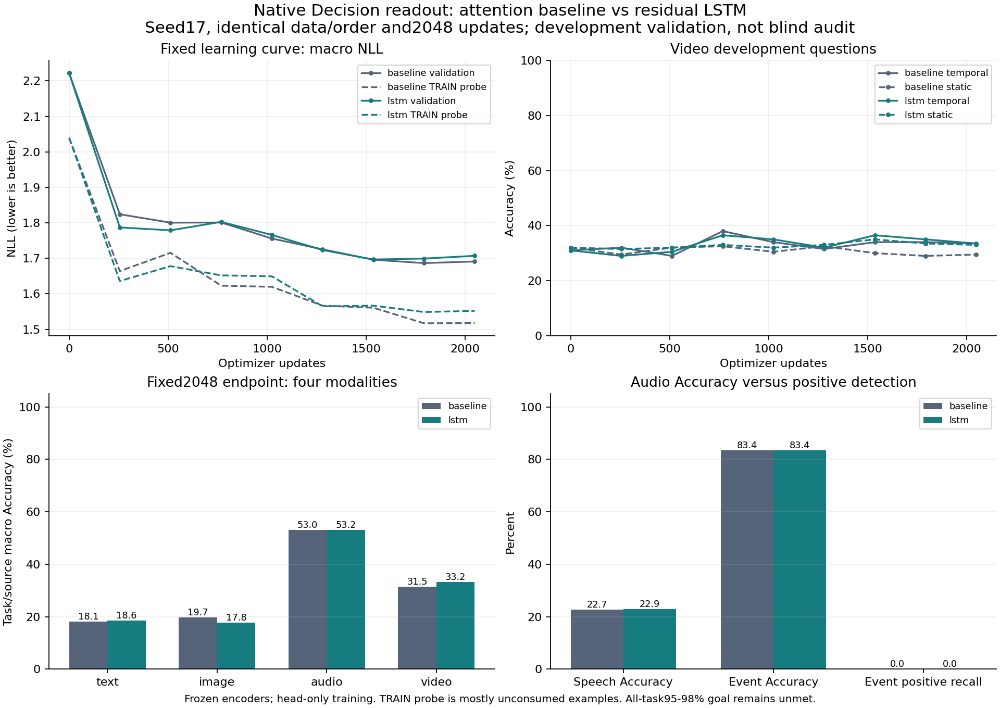

# Native Decision：通常attentionとLSTMの同条件学習比較

2026-10-16。**両方式の学習・保存・全件再現はPASS。LSTMの採用は見送る。製品品質は未達。**

[実測JSON・全課題指標・hash](R2_NATIVE_TEMPORAL_FIT_RESULTS_20261016.json) · [固定学習規則](R2_NATIVE_BASELINE_FIT_PROTOCOL_20261016.md) · [時系列設計](R2_TEMPORAL_STATE_PROTOCOL_20261016.md)

## 結論

- 通常モデル196,254,874、LSTM追加197,291,290パラメーター。いずれも量子化前の全encoder・readout合計が200M以内。
- seed17、同じ初期readout、同じ特徴・質問順・候補順序規則・2,048更新・validation選択規則で実学習した。初期の全validation/TRAIN probe logitsは完全一致。
- 固定終点の時間的動画問題は両方33.5%。LSTMでmacro NLLは悪化し、画像Accuracyも低下。動画全体の小さな改善だけでは採用しない。
- 全課題95–98%、共同入力の有効性、独立OOD、製品校正・容量・遅延は未達または未検証。既存Teacher/QATの継続・昇格ではない。

## 固定終点2,048更新の品質

値は各source内の課題平均→モダリティ内のsource平均。全体macroは4モダリティの等重み平均。sample-weighted指標もJSONに保持し、両者を混同しない。

| モデル | 入力 | Accuracy | NLL | Brier | ECE |
|---|---|---:|---:|---:|---:|
| baseline | text | 18.07% | 2.0720 | 0.8486 | 0.0952 |
| baseline | image | 19.73% | 2.1623 | 0.8646 | 0.0608 |
| baseline | audio | 53.03% | 1.1854 | 0.5494 | 0.0909 |
| baseline | video | 31.50% | 1.3444 | 0.7035 | 0.0920 |
| baseline | **macro** | **30.58%** | **1.6910** | 0.7415 | 0.0847 |
| lstm | text | 18.59% | 2.1004 | 0.8498 | 0.0938 |
| lstm | image | 17.82% | 2.2004 | 0.8744 | 0.0598 |
| lstm | audio | 53.17% | 1.1900 | 0.5537 | 0.0970 |
| lstm | video | 33.25% | 1.3375 | 0.6995 | 0.0609 |
| lstm | **macro** | **30.71%** | **1.7071** | 0.7444 | 0.0779 |

## 最良checkpointは最終checkpointと別に保持

固定selectorは階層macro NLL最小、min_delta=1e-5、同点は早いstep。途中のVideo Accuracyで選び直していない。

| モデル | 選択step | macro Accuracy | macro NLL | Video Accuracy | 消費問数 | unique問数 |
|---|---:|---:|---:|---:|---:|---:|
| baseline | 1792 | 30.71% | 1.6865 | 31.50% | 7,168 | 5,888 |
| lstm | 1536 | 30.19% | 1.6967 | 35.75% | 6,144 | 5,120 |

選択点でも全課題の最低Accuracyは0%。LSTMの高い途中Video値を、固定終点や全体品質の改善として扱わない。最良と最終の両checkpointを別processで全24,346 validation問＋1,456 TRAIN probe問に再実行し、保存logitsと全値が完全一致した。

## 学習曲線



| step | baseline macro NLL | LSTM macro NLL | baseline Video Acc | LSTM Video Acc |
|---:|---:|---:|---:|---:|
| 0 | 2.2227 | 2.2227 | 31.50% | 31.50% |
| 256 | 1.8242 | 1.7870 | 30.75% | 30.25% |
| 512 | 1.8005 | 1.7789 | 30.50% | 31.25% |
| 768 | 1.8009 | 1.8027 | 35.25% | 34.75% |
| 1024 | 1.7558 | 1.7659 | 32.25% | 33.50% |
| 1280 | 1.7254 | 1.7233 | 32.00% | 32.50% |
| 1536 | 1.6960 | 1.6967 | 32.00% | 35.75% |
| 1792 | 1.6865 | 1.6994 | 31.50% | 34.25% |
| 2048 | 1.6910 | 1.7071 | 31.50% | 33.25% |

固定TRAIN probeのNLL低下とvalidation NLL上昇が重なる警告は、baseline768、LSTM768/1792で記録。LSTM512/1280ではaggregate改善と最弱modality低下の警告も記録。終盤は改善が持続せず、単調な学習量効果を主張できない。これは1予算・1seed内の結果で、model系列の能力限界を証明しない。

## 動画の不確かさ

事前固定したscene単位paired bootstrap：200 scenes、5,000反復、seed17、percentile95%区間（NumPy linear quantile）。各sceneの全質問をまとめて再標本化し、対応する両モデルの差を取った。差はLSTM−baseline。

| 固定終点の対象 | Accuracy差（pp） | NLL差 | Brier差 |
|---|---:|---:|---:|
| all | +1.75 [-1.50, +5.00] | -0.00697 [-0.01332, -0.00069] | -0.00407 [-0.00722, -0.00096] |
| temporal_descriptive | +0.00 [-3.00, +3.00] | -0.00878 [-0.02067, +0.00265] | -0.00399 [-0.00933, +0.00128] |

動画全体のNLL/Brierには小さな改善がある。ただし時間的200問の区間は0を含み、Accuracy差は0。追加パラメーターの効果との分離も未実施で、再帰メモリ固有の利益と断定しない。選択checkpoint同士の区間もJSONに保存。観測済み開発validationであり、checkpoint選択・単一training seedの影響を含む。新しい盲検評価ではない。

## データ量・エラーの解釈

- 元corpusはTRAIN100,580問、validation24,346問。両runの消費は8,192問、unique6,656問、重複1,536問。Video512問を4巡した。全TRAINを学習したとは言わない。
- 全runの観測単位5,107、media asset3,114。text/image/audio/video各2,048問。source別：condition_relevance683、programmatic682、curriculum497、original186、Clevr4 2,048、Lombard1,024、STARSS1,024、CLEVRER2,048。選択checkpoint時点の会計は別にJSON保存。
- TRAIN probe1,456問のうち消費済みは186問（text137/image7/audio10/video32）。残りはTRAIN所属でも学習では未消費。従ってprobeとvalidationの差を通常のmemorization gapとして扱わない。消費済みVideo probe32問の終点Accuracyはbaseline50.0%、LSTM46.875%で、この小標本だけでも容量限界を断定しない。
- STARSSは両方式の最良・最終checkpointとも全問no。Accuracy83.38%でも正例のある11クラスのrecallは全て0。TRAIN bell正例0、validation water-tap正例0の不足は保持した。成功扱いしない。
- 最良checkpointのImageは両方式とも「質問された属性」を全2,048問で選べたが、その値の正答はbaseline412問、LSTM301問。属性指定の取り違えと内容読出しの失敗を区別する。Textの新relevance条件ではtextureの1文面が256問で属性不一致。これらは保存予測のpost-hoc診断で、選択規則は変更していない。
- 独立スクリプトで元のラベルと全124,926問を照合し一致。既知のgroup/media/normalized-text分割重複0。初回監査スクリプトはSTARSSにもLombardと同じPCM欄があると仮定して停止し、その失敗を保存。元のschemaに合わせた別出力で再監査した。データ自体を変更していない。

## コストと実行条件

RTX3080 Laptop16GiB、Python3.11、Torch2.6+cu124、FP32、TF32無効。encoderは凍結特徴を読み、今回のGPU実行にはロードしていない。下表は**readoutの学習・評価**であり、全encoder常駐時のメモリやend-to-end遅延ではない。package容量目標の達成も未確認。

| モデル | 学習可能params | 更新処理秒 | validation/probe秒 | main wall秒 | fresh replay秒 | peak CUDA bytes |
|---|---:|---:|---:|---:|---:|---:|
| baseline | 889,345 | 61.43 | 476.10 | 562.97 | 127.61 | 208,541,696 |
| lstm | 1,925,761 | 100.04 | 943.74 | 1067.02 | 225.29 | 275,454,464 |

各方式の独立32更新smokeも実行し、その重みを本学習には使用しなかった。smoke＋main＋replayの6process内wall合計は2040.49秒（約34.01分）。import前起動時間・既存encoder特徴抽出・CPU監査は含めない。並行した軽いCPU監査があり、厳密な専有速度benchmarkではない。クラウド費用0。最終2,048回目のoptimizer.stepは予定LR0で、消費・勾配計算は行うが重みは更新しない。

## 保存・再現

実学習sourceは両方式とも`72c1eb47dde0c81e503d3a4d783aa5528660186e`。config SHAは`45954a7240ee8da32e4b5b5dc3283994c40c4849451f27ff4fce13d3cc118f75`。比較計画SHAは`7a06775ffc3fddf3c62f05d30928480b5acd4a8097fa7b1cb476eff386c9218a`。全source/input pins、sampler、validation IDsが両runで一致。

`C:/CodexArtifacts/pretrained-reuse-r2/native-common-{baseline,lstm}-{smoke,fit,replay}-01/`に、weights、全step履歴、validation logits、最良/最終checkpoint、入力hash、時刻、実行引数を保存。比較と図は`native-common-comparison-01/`。raw media/重みはGitに追加しない。既存Teacher/QATと旧native成果物は変更していない。

実行形は以下。variantごとにsmoke→train→replay、各段階で未使用出力先と直前receiptの実SHAを使う。正確な実引数は各receiptを参照。runnerは絶対pathと全Python sourceをhash固定するため、将来の再実行は同じsource/path環境を必要とする。移動先でhash検査を外して通してはいけない。

```powershell
$env:PYTHONPATH="C:/CodexArtifacts/pretrained-reuse-r1/python-deps;C:/CodexArtifacts/pretrained-reuse-r2/native-speech-deps-01;C:/CodexWorktrees/pretrained-reuse-omni/src;C:/CodexWorktrees/pretrained-reuse-omni"
$env:OMP_NUM_THREADS="4"
python -u -m scripts.train_native_common --phase smoke --variant baseline --output <new-smoke>
python -u -m scripts.train_native_common --phase train --variant baseline --output <new-fit> --reference <new-smoke> --reference-sha256 <smoke-receipt-SHA>
python -u -m scripts.train_native_common --phase replay --variant baseline --output <new-replay> --reference <new-fit> --reference-sha256 <fit-receipt-SHA>
```

数値照合・bootstrapは`scripts/analyze_native_temporal_fit.py`、図は`scripts/plot_native_temporal_fit.py`。図専用matplotlib3.10.6/NumPy2.4.6は独立ディレクトリに導入し、学習環境は変更していない。全plot依存versionはJSONに記録。

## 次の方針と未実施

1. このLSTM候補を製品採用せず、通常版とともに固定比較基準として保持する。xLSTMへの置換を自動的に次の学習にしない。
2. 次は「同じnative情報から正しい値を取り出せるか」を優先する。消費済み/未消費を分けたTRAIN到達度とunique coverageを確認し、データ被覆不足・frozen表現からの読出し不足を切り分ける。大量の動画反復をunique data増加と呼ばない。
3. 十分な学習被覆で条件追従・内容読出しが改善した後に、時間順序への介入と同程度のパラメーター数の非再帰対照でメモリ固有の利益を確認する。現在その対照、xLSTM実行、joint/OOD、独立auditは未実施。
4. 時系列stateは質問から独立して再利用でき、JSONは候補IDと確率を返す設計を維持する。LSTMは固定画面位置のメモリでありobject trackingではない。full-clip encoderの将来情報や、未同期のaudio/videoを因果streamingと呼ばない。

R2および最終目標は未完了。精度の低さを理由に評価課題・候補数・95–98%要件を縮小しない。

## 検証

実行sourceのCI #1819成功。比較統計に3件の回帰テストを追加し、全CPUテスト2,063 passed / 1 skipped（35.04秒）、Ruff PASS、manifest25コマンドPASS。公開前に元runの全入力・source hashを再照合して一致。公開commitのCIはpush後の最終報告で確認する。
